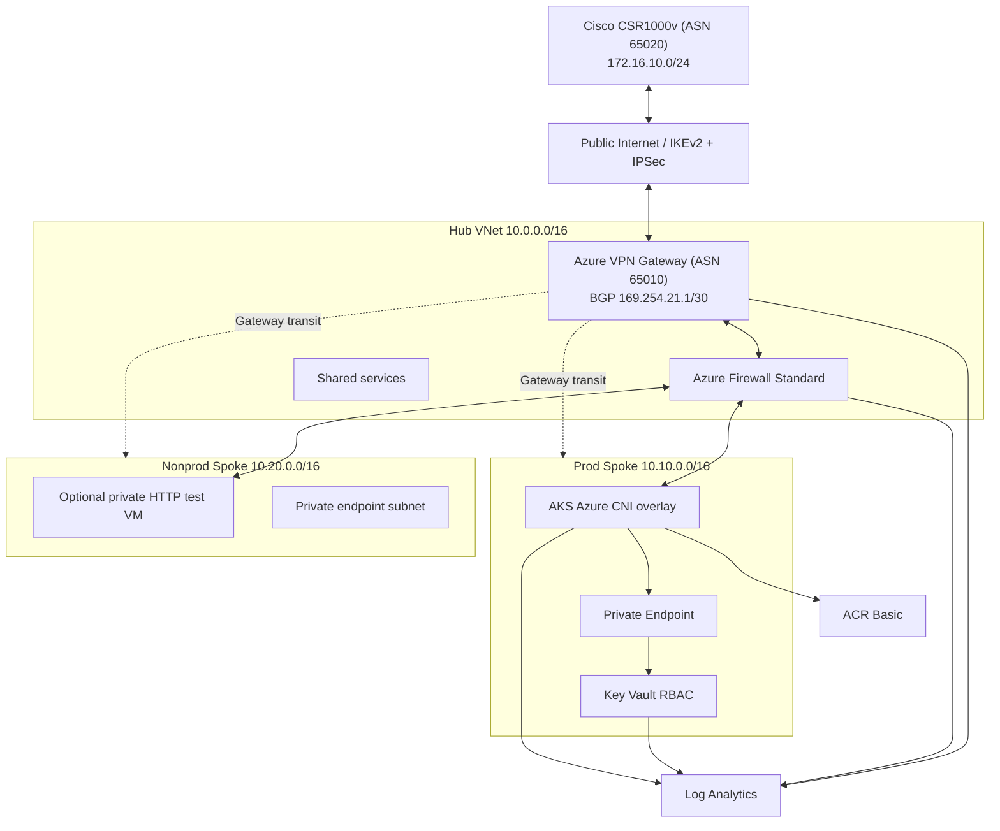

# Azure Hub-Spoke Landing Zone with Cisco On-Premises Connectivity

> Enterprise hybrid-cloud networking portfolio for Spanish and European financial-services, insurance, public-sector and consultancy roles. Demonstrates Terraform modules, hub/spoke isolation, Cisco IOS-XE IKEv2/IPsec+BGP, Azure Firewall and VPN Gateway, AKS, Key Vault private access, identity federation, GitHub approval gates, logging and FinOps controls. **This is a deployable reference POC, not an audited production blueprint.**

Verification on **3 November 2026**: both Terraform roots validate, TFLint and Helm lint pass, and six Python tests pass, including real HTTP requests. After hardening, Checkov reports **103 passed / 24 failed / 0 skipped**, down from 28 findings; cloud deployment and hybrid connectivity remain unverified. See the [verification report](docs/verification.md) and [security findings](docs/checkov-results.json) before deploying.

### Run the app locally

```bash
python3 app/server.py
# In another terminal:
curl -i http://127.0.0.1:8080/healthz
curl -i http://127.0.0.1:8080/readyz
```

Liveness returns HTTP 200. Readiness returns HTTP 503 until a nonempty `example-message` file is mounted at `/mnt/secrets-store/`; on AKS the Key Vault CSI driver supplies this file. No secret value is returned by the app. Stop the local server with Ctrl-C.

To run the same app in Docker:

```bash
docker build -t hybrid-demo:local-verify app
docker run -d --name hybrid-demo-local --read-only --cap-drop=ALL \
  --security-opt=no-new-privileges -p 127.0.0.1:8080:8080 hybrid-demo:local-verify
# Stop and remove the local container when finished:
docker rm -f hybrid-demo-local
```

Run `python3 -m unittest discover -s tests -v` for a self-contained HTTP lifecycle test using a temporary secret file and a loopback port. Run `./scripts/validate-local.sh` for the full toolchain; it exits on the first failed check, including security findings. The `Local checks` workflow runs Python tests, shell syntax, formatting, backend-disabled Terraform validation, TFLint, Helm and blocking Checkov without Azure credentials, including on fork pull requests. Checkov runs last in the local script so the other checks complete before the known security failure.

## 1. Architecture



### CIDR allocation (production environment)

| Component | Prefix |
|:--|:--|
| Hub / GatewaySubnet / AzureFirewallSubnet / shared | `10.0.0.0/16` / `10.0.0.0/27` / `10.0.1.0/26` / `10.0.2.0/24` |
| Production spoke / AKS / private endpoints | `10.10.0.0/16` / `10.10.0.0/22` / `10.10.4.0/24` |
| Non-production spoke / app / private endpoints / VM | `10.20.0.0/16` / `10.20.0.0/22` / `10.20.4.0/24` / `10.20.8.0/24` |
| On-premises LAN | `172.16.10.0/24` |
| Azure / Cisco BGP APIPA peer | `169.254.21.1` / `169.254.21.2` |
| Azure / Cisco ASN | `65010` / `65020` |

Development uses hub `10.100.0.0/16`, prod spoke `10.110.0.0/16`, nonprod spoke `10.120.0.0/16`. Cisco's LAN prefix is the same; **do not connect both Azure environments to the same Cisco router unless you explicitly design the second VPN/BGP session and route preference**.

Spoke->spoke and spoke->onprem traffic uses a `VirtualAppliance` UDR to the firewall, with BGP route propagation disabled on spoke UDRs to prevent bypass. The gateway subnet has explicit spoke-prefix routes to the firewall; the firewall uses the VPN Gateway's BGP-learned on-prem routes, with no forced-tunnel internet default. Hub->spoke peering has gateway transit, spoke->hub peering uses the remote gateway. Azure Firewall is the inspection hop, **not** the BGP peer. Private Key Vault traffic within the prod spoke follows the local VNet route rather than traversing the firewall. AKS uses a pre-created user-assigned control-plane identity with `Network Contributor` confined to its node subnet and UDR. AKS node outbound uses `userDefinedRouting` so it cannot silently create an alternate SNAT path.

Security boundaries: GatewaySubnet and AzureFirewallSubnet deliberately have no NSG (platform restrictions); NSGs are attached to shared, AKS, private-endpoint and nonprod subnets. AKS intra-cluster networking permits its production VNet CIDR, while Kubernetes NetworkPolicy restricts application pod ingress. On-prem inbound is restricted to TCP/8080 for the test VM and TCP/443 for explicitly administered private endpoints. Azure Firewall has no generic TCP/443 network rule; AKS platform egress is restricted to the AzureKubernetesService managed FQDN tag and explicitly configured application-rule FQDNs (including the ACR login server).

## 2. Prerequisites

- Azure subscription with quota for `VpnGw1`, Azure Firewall Standard, AKS nodes; rights to create role assignments, a reader/plan service principal and two writer principals. Register `Microsoft.Network`, `Microsoft.ContainerService`, `Microsoft.KeyVault`, `Microsoft.ContainerRegistry`, `Microsoft.OperationalInsights`, `Microsoft.Insights`, `Microsoft.ManagedIdentity` as necessary.
- Terraform 1.9.8 (minimum 1.6); providers locked to AzureRM `3.117.1` and AzureAD `2.53.1`. Azure CLI with current subscription; Python 3, `kubectl`, `kubelogin`, Helm, TFLint, Checkov, Docker and Containerlab on **Linux x86_64**.
- Authorized/licensed Cisco CSR1000v qcow2 image built via [vrnetlab](https://github.com/hellt/vrnetlab), tagged `vrnetlab/vr-csr:17.03.04`. Containerlab does **not** supply Cisco images or licenses. A MacBook with Apple Silicon requires an x86_64 Linux lab VM/server (CSR emulation on ARM isn't a supported fast path).
- Internet-reachable public IPv4 address pointing to the Containerlab host; permit/forward **UDP 500 and 4500** to the host, no CGNAT. Host must allow Docker port publishing. Verify the IP is the value of `CISCO_PUBLIC_IP`. An Azure Linux VM running the Containerlab WAN/Cisco lab is a simpler alternative to residential NAT.
- Decide which Github environments may approve writes; plan on protected repository with internal PRs only. Supply an admin Entra group to AKS for human Kubernetes administration.

### Terraform backend

Terraform's remote state is an Azure Blob: the Azure Storage backend stores `dev.tfstate` and `prod.tfstate` in separate keys and uses Blob leases for state locking. Storage-at-rest encryption is enabled by Azure Storage. The backend configuration in **both** `environments/{dev,prod}/versions.tf` is:

```hcl
terraform {
  backend "azurerm" {}
}
```

Run with dynamic configuration; example:

```bash
export STATE_RG=rg-hybridlz-state
export STATE_ACCOUNT=sthylz$(openssl rand -hex 4)
export STATE_CONTAINER=tfstate
export LOCATION=westeurope
./scripts/bootstrap-state.sh
cd environments/prod
terraform init \
  -backend-config="resource_group_name=$STATE_RG" \
  -backend-config="storage_account_name=$STATE_ACCOUNT" \
  -backend-config="container_name=$STATE_CONTAINER" \
  -backend-config="key=prod.tfstate" \
  -backend-config="use_azuread_auth=true"
```

GitHub OIDC identities **and** the operator must have `Storage Blob Data Contributor` on the backend Storage Account (for blob leases and writes). Allow RBAC assignment propagation. Restrict backend RBAC and container listing; configure versioning, soft delete/backup and access alerts for higher assurance. Backend Storage remains reachable publicly for hosted runners but access requires Entra RBAC; private endpoints require self-hosted runners instead.

**Data safety:** the VPN PSK is held in Terraform encrypted state even when a variable is marked `sensitive`. No real PSK, secret value or generated Cisco config should ever be committed. GitHub plan artifacts also contain sensitive plan data, retain for one day and limit workflow/artifact access. The example Key Vault secret is created **outside Terraform** to keep its value out of state.

## 3. Configure GitHub OIDC

Create three Microsoft Entra application registrations, each with a service principal and a federated credential. These examples use Azure CLI (requires privileges to register applications and create role assignments):

```bash
export GH_REPO="YOUR_GITHUB_OWNER/azure-hub-spoke-cisco"
export SUBSCRIPTION_ID="$(az account show --query id -o tsv)"
export TENANT_ID="$(az account show --query tenantId -o tsv)"

create_identity () {
  local NAME="$1" SUBJECT="$2"
  local CLIENT_ID
  CLIENT_ID="$(az ad app create --display-name "$NAME" --query appId -o tsv)"
  az ad sp create --id "$CLIENT_ID" >/dev/null
  az ad app federated-credential create --id "$CLIENT_ID" --parameters "$(python3 -c 'import json,sys; print(json.dumps({"name":sys.argv[1], "issuer":"https://token.actions.githubusercontent.com", "subject":sys.argv[2], "audiences":["api://AzureADTokenExchange"]}))' "$NAME" "$SUBJECT")" >/dev/null
  printf '%s=%s\n' "$NAME" "$CLIENT_ID"
}
create_identity "hybrid-plan"   "repo:${GH_REPO}:environment:plan"
create_identity "hybrid-apply"  "repo:${GH_REPO}:environment:production"
create_identity "hybrid-apply-dev" "repo:${GH_REPO}:environment:development"
create_identity "hybrid-deploy" "repo:${GH_REPO}:environment:production"
```

Because a GitHub OIDC subject can correspond to a GitHub **environment**, the workflow's environment name must match exactly. The two production identities can share an environment but have distinct client IDs. Repeat federation for all needed identities; a single GitHub workflow can access only the cloud role tied to the selected client ID. The dev apply identity is separate (set a different secret in the `development` environment). In a hardened deployment constrain the enterprise trust boundary further with a repository/branch protection policy.

Grant `hybrid-plan` Reader on the target subscription (or all target RGs) and Storage Blob Data Contributor on backend. The apply identity needs Contributor and rights to create RBAC assignments; for greenfield RG creation, bootstrap once with rights at subscription scope, then narrow to the provisioned resource group. Prefer `Role Based Access Control Administrator` with conditions instead of Owner where feasible. The deployment identity requires `AcrPush` on the ACR and AKS Cluster User plus Azure Kubernetes Service RBAC Writer in the `demo` namespace (or Cluster Admin for initial bootstrap; then reduce). You may need an AKS administrator to create the `demo` namespace and namespace-scoped RBAC before first rollout. These role assignments are an **operator/bootstrap** dependency; Terraform creates workload-specific identities and `AcrPull` and Key Vault Secrets User itself.

Example assignment syntax (scope appropriately):

```bash
az role assignment create --assignee "$PLAN_CLIENT_ID" --role Reader --scope "/subscriptions/$SUBSCRIPTION_ID"
az role assignment create --assignee "$PLAN_CLIENT_ID" --role 'Storage Blob Data Contributor' --scope "$STATE_ACCOUNT_ID"
az role assignment create --assignee "$APPLY_CLIENT_ID" --role Contributor --scope "/subscriptions/$SUBSCRIPTION_ID"
az role assignment create --assignee "$APPLY_CLIENT_ID" --role 'Role Based Access Control Administrator' --scope "/subscriptions/$SUBSCRIPTION_ID"
# After AKS and ACR exist, grant DEPLOY_CLIENT_ID appropriate ACR and AKS data-plane rights.
```

### GitHub repository and environment settings

Repository **Secrets**: `AZURE_PLAN_CLIENT_ID`, `AZURE_APPLY_CLIENT_ID`, `AZURE_DEPLOY_CLIENT_ID` (appropriate environment scoping), `AZURE_TENANT_ID`, `AZURE_SUBSCRIPTION_ID`, `VPN_PSK` (32-128 random characters, e.g. generate with `openssl rand -hex 32`). `AZURE_APPLY_CLIENT_ID` may differ by environment. Never set an Azure client secret.

Repository **Variables**: `STATE_RG`, `STATE_ACCOUNT`, `STATE_CONTAINER`, `CISCO_PUBLIC_IP`. For app delivery also set `ACR_NAME`, `AKS_NAME`, `AZURE_RG`, `KEYVAULT_NAME`, `WORKLOAD_CLIENT_ID` using `terraform output -raw` after successful apply. Azure endpoints exposed in public GitHub settings should be reviewed for your threat model.

Create GitHub Environments `plan`, `development`, `production`. Production: required reviewers, no self-approval, deployment branch `main` only; plan: no required reviewers; development: approval recommended. Protect `main`, require PR, review, green CI, and disallow force-push. Set GitHub Actions **Read and write permissions** for pull request comments/issues where supported or rely on each workflow's scoped `permissions`. Do not execute cloud-authenticated PR jobs from external forks.

## 4. Deploy the landing zone

```bash
az login
az account set --subscription "$SUBSCRIPTION_ID"
export TF_VAR_onprem_public_ip="$CISCO_PUBLIC_IP"
export TF_VAR_vpn_shared_key="$(openssl rand -hex 32)" # Use same value for Cisco + GitHub Secret.
cd environments/prod
terraform fmt -check -recursive ../..
terraform init -backend-config="resource_group_name=$STATE_RG" \
 -backend-config="storage_account_name=$STATE_ACCOUNT" \
 -backend-config="container_name=$STATE_CONTAINER" \
 -backend-config="key=prod.tfstate" -backend-config="use_azuread_auth=true"
terraform validate
terraform plan -var-file=config.tfvars -out=tfplan
terraform apply tfplan
terraform output
```

First VPN Gateway provisioning can take 30-60 minutes or longer. Run `terraform providers lock -platform=darwin_arm64 -platform=linux_amd64` when connectivity is available, and commit the generated `.terraform.lock.hcl` for each root environment; plugin and provider binaries must **never** be committed. Both environments deploy full stacks and therefore incur separate costs; normally deploy only one at a time.

**Optional private AKS**: set `private_aks=true` and use a GitHub self-hosted runner on a peered, VPN-connected network for app deployment. Default public API has Entra RBAC and local accounts disabled but cannot be simultaneously restricted to GitHub-hosted ephemeral IPs with a static allowlist. For a real production rollout, choose private API or dedicated fixed-egress runner + `aks_authorized_ip_ranges`.

**Optional connectivity test VM**: `terraform plan -var-file=config.tfvars -var='enable_test_vm=true' -var="ssh_public_key=$(cat ~/.ssh/id_ed25519.pub)"`. VM has no public IP. The cloud-init local HTTP listener answers on TCP/8080, reachable only through allowed hybrid routing.

## 5. Containerlab Cisco deployment

See `cisco/containerlab.yaml`, `cisco/wan/Dockerfile`, `cisco/wan-init.sh`, `cisco/ios-xe-config.tftpl` and `scripts/render-cisco.py`. **The template is fully specified; only public peer addresses and PSK are rendered at deployment.** Cisco CSR1000v is a licensed QEMU appliance packaged with vrnetlab; image import/build is a manual step with authorized software.

```bash
cd cisco
docker build -t hybrid-lab-wan:1.0 wan/
# Import licensed CSR image using vrnetlab build procedure; tag vrnetlab/vr-csr:17.03.04
cd ..
export AZURE_VPN_IP="$(cd environments/prod && terraform output -raw vpn_public_ip)"
export CISCO_PUBLIC_IP="$TF_VAR_onprem_public_ip"
export VPN_PSK="$TF_VAR_vpn_shared_key"
export ENVIRONMENT=prod
python3 scripts/render-cisco.py
sudo containerlab deploy -t cisco/containerlab.yaml
sudo containerlab inspect -t cisco/containerlab.yaml
```

Linux x86_64 host with UDP 500/4500 reachable from the internet. The lab's `wan` node DNATs published UDP ports to CSR `Gi2` (`192.0.2.2/30`); `Gi3` (`172.16.10.1/24`) connects the `lan` container (`172.16.10.10/24`). The Docker host/router also needs upstream forwarding to the published ports. Verify `sudo ss -lunp | grep -E ':(500|4500)'` and packet captures on host and CSR if tunnel setup stalls. **Do not put a 192.0.2.x lab address into Azure's Local Network Gateway**: it must reference the actual reachable public IP (even behind NAT).

Cisco config uses a route-based VTI, IKEv2 AES-CBC-256 + SHA256, DH14, IPsec ESP-AES256/SHA256, PFS14, 27000-second Child-SA lifetime and BGP. `crypto isakmp policy` is intentionally omitted: that syntax is for IKEv1. Cisco IOS-XE command support can vary by licensed image/release. Confirm IPsec tunnel proposal compatibility on the selected release before using it outside the lab.

### Matching variables

| Terraform / output | Cisco variable or setting |
|:--|:--|
| `vpn_shared_key` (state-sensitive) | `VPN_PSK` pre-shared-key local and remote |
| Terraform `vpn_public_ip` output | `AZURE_VPN_IP`, tunnel destination, IKE peer |
| `onprem_public_ip` | `CISCO_PUBLIC_IP`, IKE identity local / public NAT address |
| Azure ASN `65010` | Cisco `neighbor ... remote-as 65010` |
| On-prem ASN `65020` | Cisco `router bgp 65020` |
| Azure APIPA `169.254.21.1` | Cisco BGP neighbor |
| On-prem APIPA `169.254.21.2` | Cisco `Tunnel0` address |
| On-prem `172.16.10.0/24` | Cisco `Gi3`, BGP exported network |
| Prod/dev spoke CIDRs | Cisco `AZURE-IN` prefix-list |

### Verify on both sides

```text
CSR# show crypto ikev2 sa
CSR# show crypto ipsec sa
CSR# show interface Tunnel0
CSR# show ip bgp summary
CSR# show ip bgp neighbors 169.254.21.1 routes
CSR# show ip route bgp
```

```bash
az network vpn-connection show -g hybridlz-prod-rg -n hybridlz-prod-cisco-s2s --query connectionStatus -o tsv
az network vnet-gateway list-bgp-peer-status -g hybridlz-prod-rg -n hybridlz-prod-vpngw -o table
az network vnet-gateway list-learned-routes -g hybridlz-prod-rg -n hybridlz-prod-vpngw -o table
# To test the private VM from the simulated LAN:
docker exec -it clab-azure-hybrid-cisco-lan sh -c 'wget -qO- http://10.20.8.X:8080'
```

Replace `10.20.8.X` with `terraform output -raw test_vm_private_ip` once `enable_test_vm=true`; set that VM's IP in the command. Check effective UDRs and NSG rules before debugging firewall. A tunnel/BGP up **does not prove data path connectivity**; test both source and destination ports and firewall logs. From within the lab use `ip route`, `tcpdump` (install on LAN if needed), and Cisco `show ip route`.

## 6. CI/CD pipeline

- `terraform-pr.yml`: protected internal PR → format → Azure OIDC → remote backend init → validate → TFLint → blocking Checkov → planned changes and redacted PR comment. Plan is for **both** roots. If a scanner rejects a deliberately documented trade-off, fix it or add a narrowly scoped suppression with an explanation; do **not** disable the scanner.
- `terraform-apply.yml`: push `main` or manual dispatch → plan with read identity → upload short-lived binary plan → GitHub environment reviewer approval → apply the exact saved plan with write identity. Separate plan and apply OIDC credentials ensure review separation; plans may fail due to real provider differences or network policy restrictions, and those failures stop approval.
- `drift-detection.yml`: daily at 05:20 UTC → `terraform plan -refresh-only -detailed-exitcode` for both roots; creates one GitHub Issue per environment if drift is detected. Refresh-only deliberately detects changes to managed resource values, not all possible changes to the desired configuration. The normal PR plan also detects config drift.
- `app-deploy.yml`: image build → OIDC `AcrPush` → immutable SHA-tagged push → `kubelogin` Entra auth → Helm upgrade and rollout. Private Key Vault is accessed by workload identity via CSI, not embedded Kubernetes Secret or access key.

Before running app delivery, use a trusted runner/VM with private Key Vault connectivity and Azure Secrets Officer RBAC:

```bash
export KEYVAULT_NAME="$(cd environments/prod && terraform output -raw keyvault_name)"
./scripts/put-sample-secret.sh  # prompts without echo, no TF state
```

For a private Key Vault, this command will **not** work from a default GitHub-hosted runner or ordinary laptop without VPN. On-premises clients must resolve `VAULTNAME.vault.azure.net` to the private endpoint IP (a conditional DNS forwarder/Private Resolver in a real environment, or a temporary hosts entry for the lab). Retrieve the IP with `terraform output -raw keyvault_private_ip`; never disable certificate hostname verification. The CSI workload requires a secret named `example-message` before the Helm deployment can become ready. Azure RBAC propagation can take several minutes.

Inspect:

```bash
kubectl get pods -n demo
kubectl get secretproviderclass -n demo
kubectl port-forward -n demo svc/hybrid-demo 8080:8080
curl http://127.0.0.1:8080/readyz
```

The app only returns `key_vault_secret_mounted: true`; it never exposes the secret.

## 7. FinOps: illustrative recurring costs

**Rough order-of-magnitude EUR/month for one full-time West Europe POC stack, 730h, excluding VAT; not a live quotation.** The Azure Pricing Calculator / Infracost should be used with your actual subscription and current SKU prices before deployment. Microsoft pricing pages may display region-dependent or unavailable rates without a signed-in context.

| Component | Approx. € / month | Drivers |
|:--|--:|:--|
| Azure VPN Gateway VpnGw1 | 120–220 | Gateway uptime, data egress |
| Azure Firewall Standard | 750–1,100 | Provisioned hours **plus** data processing |
| AKS control plane (Free tier) | 0 | Excludes worker compute / disks |
| AKS 2 x D2as_v5 workers + disks | 130–270 | VM size, region, disks, uptime |
| ACR Basic | 4–10 | Registry storage |
| Key Vault + private endpoint | 7–20 | Requests, private endpoint hours |
| Log Analytics | 0–50+ | Ingestion, 30-day retention, 1 GB/day cap |
| Public IPs, peering, storage, bandwidth | 10–100+ | Addresses, data transfer, state |
| **Indicative total** | **€1,020–1,770+** | Not production SLA pricing |

The firewall and VPN are the dominant fixed charges; leaving a full POC running across both dev and prod can more than double costs. Use tags `environment`, `owner`, `costCenter`, `project`, and `managedBy` for reporting. Azure Cost Management budgets and anomaly alerts should be set manually at subscription/RG scope before deployment. `daily_quota_gb=1` limits Log Analytics ingestion but does not guarantee zero additional charges. Shutdown of VMs does **not** stop Gateway/Firewall billing; destroy the stack.

## 8. Design decisions and trade-offs

- **Hub/spoke vs flat network:** isolated routing/security domains, predictable routing, shared VPN; peering is nontransitive and costs/latency increase.
- **Azure Firewall vs Cisco NVA in Azure:** managed lifecycle, standard logs, policy as code, no NVA VM patching; substantially higher hourly cost than small VM appliances. Cisco remains the on-prem network edge.
- **Route-based IPSec + BGP:** dynamic route exchange and future multi-prefix connectivity; requires supported gateway tier and careful gateway-subnet UDRs. Site on a laptop behind CGNAT is not a feasible end-to-end test.
- **Key Vault private endpoints and RBAC:** no public data-plane endpoint, granular managed-identity access, private DNS; GitHub-hosted automation cannot write the sample secret directly from outside the VNet.
- **Public AKS control plane for demo by default:** allows hosted deployment but less isolated than private AKS. The sample uses Entra RBAC, disables local Kubernetes admin accounts, and permits switching to private AKS with a network-connected runner.
- **Azure CNI overlay:** conserves VNet node IPs while still using Azure CNI; Kubernetes policy used for pod isolation.
- **Pinning and GitHub OIDC:** no persistent app secret, explicit approvals, short-lived cloud tokens; trust and roles still require initial operator bootstrapping.
- **Not all subnet NSGs are equal:** gateway/firewall subnets cannot use the same NSG policy as workloads; AKS intra-cluster traffic must not be blanket-blocked.

### Spanish market context

Financial institutions, insurance firms and public-sector organizations in Spain frequently need to integrate existing private-network estates with segmented cloud workloads. This project demonstrates the Azure networking, Cisco routing, deployment governance and cost-awareness skills useful for hybrid-cloud infrastructure teams, while remaining an illustrative POC rather than a compliance certification.

## 9. Security and quality checklist

- [x] Source-controlled Terraform has no plaintext PSK or sample secret. PSK remains in **restricted encrypted remote Terraform state** as a provider limitation.
- [x] Azure Key Vault uses RBAC, private endpoint, disabled public data-plane access, soft delete and purge protection.
- [x] Hub firewall allows only defined private ports and AKS platform FQDNs, with implicit deny elsewhere.
- [x] Per-workload NSGs, platform exceptions documented; Kubernetes NetworkPolicy for sample app.
- [x] Gateway, Firewall, AKS and Key Vault send diagnostics to the same Log Analytics workspace.
- [x] Resource tags from common locals (no unsupported AzureRM `default_tags`).
- [x] Azure Storage backend uses Entra RBAC, encrypted blobs, versioning and lease-based locking.
- [x] GitHub Actions uses OIDC, reviewer-approved apply and blocking formatting/scanning.
- [x] Terraform provider versions and action release versions pinned; commit `.terraform.lock.hcl` after init.
- [ ] Verify end-to-end deployment, IPsec SA, BGP neighbors, VM HTTP and AKS CSI mount in a real Azure subscription.
- [ ] Attach Azure Policy assignments, Defender, alerts, budgets, dedicated deployment runners and multi-region DR before claiming production readiness.

### Local review commands

```bash
terraform version
terraform fmt -check -recursive
cd environments/prod
terraform init -backend=false -input=false
terraform validate
cd ../..
tflint --init
tflint --chdir=environments/prod
checkov -d . --framework terraform --quiet
python3 -c 'import yaml; yaml.safe_load(open("cisco/containerlab.yaml"))'
helm lint helm/hybrid-demo --set azure.keyvaultName=a --set azure.workloadClientId=b --set azure.tenantId=c
python3 -m compileall -q app scripts
```

After authenticating and bootstrapping state, validate remote configuration with `terraform init`, `terraform plan -var-file=config.tfvars`, and inspect Terraform's actual output. Checkov may flag the documented sample compromises, especially public AKS API and ACR; the CI intentionally fails until remedied or an individually justified policy exemption is approved.

## 10. Cleanup (to stop costs)

```bash
# Delete Helm release first; let AKS detach CSI/PE usage.
helm uninstall hybrid-demo -n demo || true
sudo containerlab destroy -t cisco/containerlab.yaml || true
cd environments/prod
terraform plan -destroy -var-file=config.tfvars -out=destroy.tfplan
terraform apply destroy.tfplan
```

Alternatively `terraform destroy -var-file=config.tfvars` with the required environment variables supplied. Terraform manages resource graph dependencies, so AKS, PE connections, role assignments, peerings, gateway, firewall and networks are removed in reverse graph order; allow long VPN Gateway deletion. Purge-protected Key Vault remains **soft-deleted** until retention expires and its **name cannot be reused** immediately. State backend is deliberately NOT destroyed automatically; remove it only after both environments are destroyed and artifacts/backups are no longer required. Ensure no production resources share these resource groups before deletion.

## 11. What to demo to recruiters

1. **Network topology + routing:** Azure hub-spoke, private endpoints, effective UDR next hops, firewall policy and explicit gateway transit peering.
2. **PR workflow:** a Terraform PR showing the plan comment alongside `fmt`, `validate`, TFLint and Checkov checks.
3. **Protected apply:** GitHub production environment approval, plan-artifact download and approved Terraform apply.
4. **Cisco VPN/BGP:** `show crypto ikev2 sa`, `show crypto ipsec sa`, `show ip bgp summary`, Azure learned BGP routes and on-prem->Azure TCP/8080 private VM test.
5. **AKS delivery:** ACR SHA-tagged image, Helm rollout, pod with Key Vault CSI mount, `/readyz` response and Log Analytics audit logs.

### References

- [Microsoft: Hub-spoke design](https://learn.microsoft.com/en-us/azure/networking/design-guide/hub-spoke)
- [Microsoft: AKS egress and Azure Firewall](https://learn.microsoft.com/en-us/azure/aks/limit-egress-traffic)
- [Microsoft: VPN Gateway BGP configuration](https://learn.microsoft.com/en-us/azure/vpn-gateway/configure-bgp)
- [Containerlab: Cisco CSR1000v kind](https://containerlab.dev/manual/kinds/vr-csr/)
- [Microsoft: Azure Firewall logging](https://learn.microsoft.com/en-us/azure/firewall/monitor-firewall)
- [Microsoft: VPN Gateway pricing](https://azure.microsoft.com/en-us/pricing/details/vpn-gateway/)
