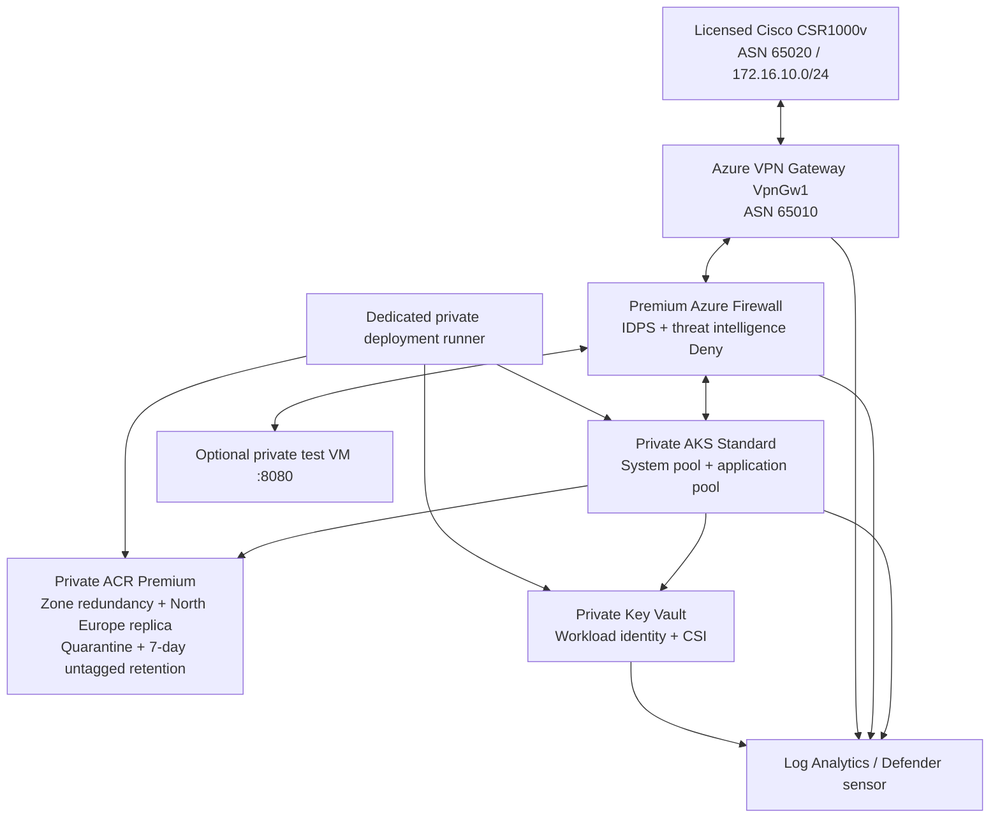

# Azure Hub-Spoke Landing Zone with Cisco Connectivity

**Verification status: local and CI verification completed, with documented security findings — 3 November 2026.** Nine tests, Terraform validation and mocked plans for both environments, TFLint, Helm and container checks passed. The image scan found zero HIGH/CRITICAL vulnerabilities. Two legacy Checkov findings remain blocking; Azure deployment and Cisco end-to-end connectivity are unverified. [Verification evidence](docs/verification.md).

Terraform reference architecture for private AKS workloads, a Premium Azure Firewall, private geo-replicated ACR, Key Vault CSI access and a Cisco IKEv2/IPsec+BGP connection. **This is a reference POC under review, not a deployed or audited production landing zone.**

The paid private architecture is prepared for review on `hardening/private-architecture`. See the [deployment plan](docs/deployment-plan.md), [verification report](docs/verification.md) and [remaining scanner findings](docs/checkov-results.json). No paid resources have been provisioned. A real Azure deployment plan and Cisco connectivity test still require the external prerequisites below.

## Architecture



| Component | Production | Development |
| --- | --- | --- |
| Hub | `10.0.0.0/16` | `10.100.0.0/16` |
| Production workload spoke | `10.10.0.0/16` | `10.110.0.0/16` |
| Nonproduction spoke | `10.20.0.0/16` | `10.120.0.0/16` |
| Gateway / firewall / shared subnet offsets | `.0.0/27` / `.1.0/26` / `.2.0/24` | Same offsets within hub |
| AKS / private endpoint offsets | `.0.0/22` / `.4.0/24` | Same offsets within workload spoke |
| Optional test VM subnet | `10.20.8.0/24` | `10.120.8.0/24` |
| Azure / Cisco BGP peers | `169.254.21.1` / `169.254.21.2` | Same; deploy only one Cisco session unless redesigned |

Spoke defaults, on-premises routes and explicit peer-spoke routes point to the firewall. BGP propagation is disabled on spoke route tables; the gateway has spoke-prefix routes through the firewall. Peering enables gateway transit and forwarded traffic. Key Vault and ACR private endpoints in the workload spoke use local routing. Private DNS zones for AKS, ACR and Key Vault link to all three VNets.

Gateway and Firewall subnets have no NSG; workload subnets do. Private endpoints admit HTTPS from AKS, the on-premises LAN and the shared runner subnet. The application NetworkPolicy allows TCP/8080 ingress from pods in its own namespace. The Helm release targets the application node pool; system nodes are reserved for critical addons.

AKS uses Azure CNI overlay, UDR egress, Entra RBAC, disabled local accounts, workload identity and automatic patch upgrades. Both pools use host encryption and 128-GiB ephemeral OS disks on `Standard_D4ds_v5`. A supplied Disk Encryption Set covers supported managed disks; **ephemeral OS disks use platform-managed encryption, not customer-managed keys**. The kubelet identity and its AcrPull role exist before cluster creation. The control-plane identity has Network Contributor on the workload VNet and UDR, Private DNS Zone Contributor on the AKS zone, Reader on the supplied DES and Managed Identity Operator on the kubelet identity.

## Run locally

```bash
python3 app/server.py
# In another terminal:
curl -i http://127.0.0.1:8080/healthz
curl -i http://127.0.0.1:8080/readyz
```

Liveness returns 200. Readiness returns 503 until a nonempty `/mnt/secrets-store/example-message` is mounted. On AKS, the Key Vault CSI driver supplies it. Responses never return the secret value. Stop the server with Ctrl-C.

```bash
docker build -t hybrid-demo:private-review app
docker run -d --name hybrid-demo-local --read-only --cap-drop=ALL \
  --security-opt=no-new-privileges -p 127.0.0.1:8080:8080 hybrid-demo:private-review
# Stop the local container when finished:
docker rm -f hybrid-demo-local
```

The image runs as a non-root user on the supported Python 3.12 / Alpine 3.23 base. A successful local readiness test with a temporary file proves the HTTP behavior, not a real Azure CSI mount.

## Verify without Azure credentials

Use Terraform 1.9.8, Python 3.12+, TFLint 0.57.0, Helm 3.18.4, Checkov 3.4.3 and PyYAML 6.0.3. Terraform providers are AzureRM 3.117.1 and AzureAD 2.53.1, locked per environment.

```bash
python3 -m venv /tmp/hybridlz-verify
source /tmp/hybridlz-verify/bin/activate
python3 -m pip install checkov==3.4.3 PyYAML==6.0.3
./scripts/validate-local.sh
```

The script runs Python HTTP/architecture tests, compilation, shell syntax, Terraform formatting, backend-disabled init/validate, mocked plan assertions for both environments, TFLint, YAML parsing, Helm lint and blocking Checkov. Internet access is required for providers/plugins. `Local checks` runs the same categories in credential-free GitHub jobs.

```bash
terraform -chdir=environments/dev test -var-file=config.tfvars
terraform -chdir=environments/prod test -var-file=config.tfvars
```

These tests use mocked providers and synthetic IPs/IDs and do not create resources. They assert private APIs, paid tiers, node isolation, encryption settings, registry quarantine and firewall blocking. The remaining CKV_AZURE_164 findings recommend legacy Docker Content Trust, which cannot be enabled on new registries after May 2026. They remain unsuppressed and block the security gate; see [Microsoft's migration guidance](https://learn.microsoft.com/en-us/azure/container-registry/container-registry-content-trust-deprecation). A security reviewer must validate the replacement signing/admission control before approving any policy exception.

## Prerequisites for a deployable plan

- Azure subscription permissions for resource provisioning and scoped RBAC, regional quota for VPN/Firewall and four D4ds_v5 AKS nodes, and host-encryption support/registration. Review live regional SKU availability before deployment.
- Same-region, same-subscription Disk Encryption Set with a healthy customer-managed key, purge-protected vault, key rotation and a DES identity authorized on that key. This is a security bootstrap dependency supplied as `disk_encryption_set_id`; this stack does not create or change its key vault.
- At least one real AKS administrator Entra group UUID.
- An Azure Blob backend with Entra RBAC and distinct `dev.tfstate` / `prod.tfstate` keys.
- A dedicated Linux x86_64 self-hosted runner labeled `azure-private`, using Azure DNS or a tested conditional forwarder, with private connectivity to AKS, ACR and Key Vault. A runner in the shared subnet is explicitly allowed to the private endpoints. Provision this management path before a full-stack deployment; do not open service public endpoints to accommodate a hosted runner.
- Approved Notation certificate/trust policy at strict verification level, Notation and Trivy installed on the deployment runner, and a separate security-controlled signing/quarantine-release process.
- Microsoft Defender for Containers enabled and reviewed once at subscription scope by the subscription owner. The AKS sensor is configured here; enabling a sensor or selecting Premium ACR alone does not establish subscription scanning or prove that vulnerabilities were assessed.
- For the Cisco portion: authorized CSR1000v image `vrnetlab/vr-csr:17.03.04`, Containerlab on Linux x86_64, a reachable public IPv4 forwarding UDP 500/4500, and a securely supplied random VPN PSK. The user currently has no Cisco lab, so full hybrid verification is blocked.

Deploy one environment first. Both roots provision a full paid stack. The replica defaults to North Europe; choose a zone-capable region different from the primary. Geo-replicating ACR does not provide multi-region AKS or application disaster recovery.

## State and GitHub OIDC

`scripts/bootstrap-state.sh` creates a backend storage account/container, enables TLS 1.2, disables anonymous blob access and enables versioning. Supply `STATE_RG`, `STATE_ACCOUNT`, `STATE_CONTAINER` and `LOCATION`. Give operators and OIDC principals Storage Blob Data Contributor on that account. State uses Azure Blob leases. Backend access from hosted tooling remains Entra-authenticated; a private backend requires additional runner DNS/network setup.

Create separate Entra app/service principals and GitHub federated credentials with issuer `https://token.actions.githubusercontent.com`, audience `api://AzureADTokenExchange`, and subjects:

| Identity | Federated subject | Azure access |
| --- | --- | --- |
| Plan | `repo:krishnagmx/azure-hub-spoke-cisco:environment:plan` | Reader on target resources; backend blob access |
| Prod apply | `repo:krishnagmx/azure-hub-spoke-cisco:environment:production` | Scoped provisioning and RBAC rights; backend blob access |
| Dev apply | `repo:krishnagmx/azure-hub-spoke-cisco:environment:development` | Same rights scoped to dev |
| App deploy | `repo:krishnagmx/azure-hub-spoke-cisco:environment:production` | AcrPull; AKS Cluster User and namespace-scoped AKS RBAC Writer |

The app deployment identity must not hold AcrQuarantineWriter or signing permissions. A separate approved publisher/scanner releases scanned and signed image digests and required signature artifacts. With quarantine enabled, an ordinary AcrPull identity cannot consume an unreleased image. The image build/publish/sign/release process is a security bootstrap prerequisite, not an implemented automatic release pipeline in this repository.

GitHub secrets: `AZURE_PLAN_CLIENT_ID`, `AZURE_APPLY_CLIENT_ID` (environment scoped), `AZURE_DEPLOY_CLIENT_ID`, `AZURE_TENANT_ID`, `AZURE_SUBSCRIPTION_ID`, `VPN_PSK`. No client secret is required.

GitHub variables: `STATE_RG`, `STATE_ACCOUNT`, `STATE_CONTAINER`, `CISCO_PUBLIC_IP`, `DISK_ENCRYPTION_SET_ID`, `AKS_ADMIN_GROUP_OBJECT_IDS` (JSON array). For app rollout also set `ACR_NAME`, `AKS_NAME`, `AZURE_RG`, `KEYVAULT_NAME`, `WORKLOAD_CLIENT_ID` from Terraform outputs.

Create protected `plan`, `development` and `production` GitHub environments. Require reviewers, disallow self-approval and restrict deployment environments to `main`. Protect `main` with reviewed PRs and successful checks. Do not give private deployment runners to untrusted fork jobs. GitHub login only authorizes publishing code; these Azure identities and environment rules are separate prerequisites.

## Plan, review, then deploy

The [deployment plan](docs/deployment-plan.md) is an architecture/rollout proposal. No live saved Terraform plan exists yet because real DES, administrator, network/runner and Cisco inputs are missing. Mock plans must never be applied.

After bootstrap, run from an approved operator/runner:

```bash
export TF_VAR_onprem_public_ip="$CISCO_PUBLIC_IP"
export TF_VAR_vpn_shared_key="$VPN_PSK" # Load from the approved secret store.
export TF_VAR_disk_encryption_set_id="$DISK_ENCRYPTION_SET_ID"
export TF_VAR_aks_admin_group_object_ids="$AKS_ADMIN_GROUP_OBJECT_IDS"
terraform -chdir=environments/prod init \
  -backend-config="resource_group_name=$STATE_RG" \
  -backend-config="storage_account_name=$STATE_ACCOUNT" \
  -backend-config="container_name=$STATE_CONTAINER" \
  -backend-config="key=prod.tfstate" -backend-config="use_azuread_auth=true"
terraform -chdir=environments/prod plan -input=false -var-file=config.tfvars -out=review.tfplan
terraform -chdir=environments/prod show -no-color review.tfplan
# Only after review and approval of the actual saved plan:
terraform -chdir=environments/prod apply review.tfplan
```

The Terraform Apply workflow is manual. It defaults to plan only; applying requires `apply=true`, `main`, a green security job and protected-environment approval. Cloud workflows use private runners. PR planning is restricted to internal branches. Daily drift detection uses refresh-only plans; it does not replace normal desired-configuration plans. Plan artifacts can contain sensitive values and are retained for one day. VPN PSKs necessarily enter encrypted restricted Terraform state; never commit plans, state, generated Cisco configs or secret files.

## App and Cisco verification

On a private-network operator with Key Vault Secrets Officer access, set `KEYVAULT_NAME` and run `./scripts/put-sample-secret.sh` to create `example-message` outside Terraform. Supply an approved, signed, quarantine-released digest to the manual app workflow. It verifies the Notation signature and fails on Trivy HIGH/CRITICAL findings before deploying that exact digest with Helm. The runner's strict trust policy and certificate must be controlled by the security operator. Admission-time signature enforcement remains a production rollout gate; CI verification alone does not prevent an unrelated privileged cluster user from deploying other images.

```bash
kubectl rollout status -n demo deployment/hybrid-demo
kubectl get secretproviderclass -n demo
kubectl port-forward -n demo svc/hybrid-demo 8080:8080
curl -i http://127.0.0.1:8080/readyz
```

After a licensed lab exists, build `cisco/wan/Dockerfile` as `hybrid-lab-wan:1.0`, set `AZURE_VPN_IP` from `vpn_public_ip`, `CISCO_PUBLIC_IP`, `VPN_PSK` and `ENVIRONMENT`, then run `python3 scripts/render-cisco.py`. Generated config is mode 0600 and Git-ignored. Deploy with `sudo containerlab deploy -t cisco/containerlab.yaml` on the Linux lab. Azure and Cisco use IKEv2 AES256/SHA256, DH14, ESP AES256/SHA256, PFS14 and a 27000-second Child-SA lifetime.

Confirm Cisco `show crypto ikev2 sa`, `show crypto ipsec sa`, `show ip bgp summary` and `show ip route bgp`; compare Azure VPN connection state, BGP peers and learned routes. A tunnel-up status alone does not prove data-path connectivity. Enable the private test VM with `enable_test_vm=true` and an SSH public key, then fetch its TCP/8080 service from the simulated LAN. Record sanitized evidence before claiming end-to-end verification.

## Costs and cleanup

The paid design adds Premium Firewall, AKS Standard, four D4ds_v5 workers, two-region Premium ACR, private endpoints, a private runner, a security-managed key/DES and subscription-wide Defender charges. VPN, Firewall, registry replicas and managed service tiers continue billing even when workloads are idle. The old lower-cost POC estimate does not apply. Review the [Azure Pricing Calculator](https://azure.microsoft.com/en-us/pricing/calculator/) for the actual region, agreement, currencies and data volumes; approve a budget before provisioning.

To retire a deployed environment, uninstall its Helm release, destroy the Cisco lab, review `terraform plan -destroy -var-file=config.tfvars -out=destroy.tfplan`, then approve and apply that destroy plan. Do not delete the separately owned DES/key vault or subscription-wide Defender configuration as part of stack cleanup. Purge-protected Key Vault names remain unavailable while soft-deleted. Remove the state backend only after both environments and required recovery artifacts are retired.

## References

- [Microsoft hub/spoke architecture](https://learn.microsoft.com/en-us/azure/networking/design-guide/hub-spoke)
- [AKS private clusters and DNS](https://learn.microsoft.com/en-us/azure/aks/private-clusters)
- [AKS customer-managed keys](https://learn.microsoft.com/en-us/azure/aks/azure-disk-customer-managed-keys)
- [ACR quarantine flow and separate release permissions](https://github.com/Azure/acr/blob/main/docs/preview/quarantine/readme.md)
- [Defender container vulnerability assessment](https://learn.microsoft.com/en-us/azure/defender-for-cloud/enable-vulnerability-assessment)
- [Containerlab Cisco CSR1000v](https://containerlab.dev/manual/kinds/vr-csr/)

`azure-hub-spoke-cisco.md` is the original source bundle and includes the historical lower-cost design. Use the executable configuration and this README for the current review branch.
