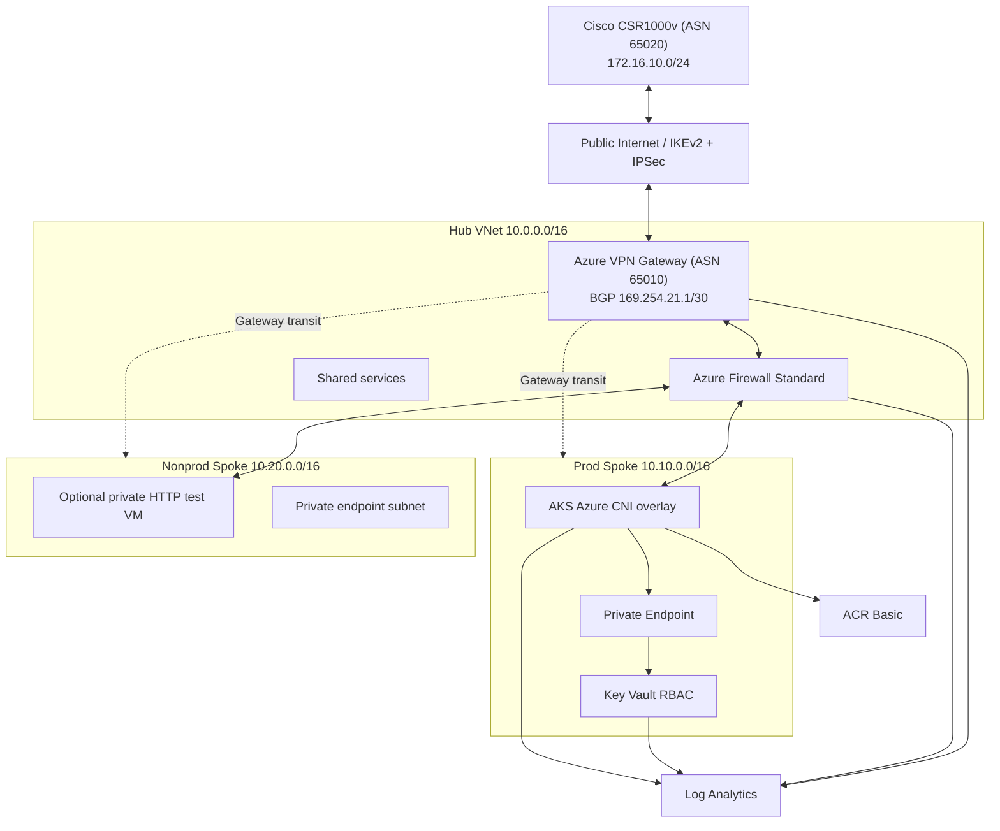

# Complete repository source — Azure Hub-Spoke + Cisco

The following **55 files** are the complete source for the ZIP distribution. Each heading is the exact repository-relative path; code is not abbreviated.

Use the ZIP for actual installation; this document is an inspectable file-by-file listing.

### modules/network/locals.tf

`````hcl
locals {
  # NSGs are intentionally absent from GatewaySubnet and AzureFirewallSubnet.
  spoke_subnets = {
    prod_aks    = azurerm_subnet.prod_aks.id
    prod_pe     = azurerm_subnet.prod_pe.id
    nonprod_app = azurerm_subnet.nonprod_app.id
    nonprod_pe  = azurerm_subnet.nonprod_pe.id
    nonprod_vm  = azurerm_subnet.nonprod_vm.id
  }
}
`````

### modules/network/main.tf

`````hcl
resource "azurerm_virtual_network" "hub" {
  name                = "${var.name_prefix}-hub-vnet"
  resource_group_name = var.resource_group_name
  location            = var.location
  address_space       = [var.hub_cidr]
  tags                = var.tags
}
resource "azurerm_virtual_network" "prod" {
  name                = "${var.name_prefix}-prod-vnet"
  resource_group_name = var.resource_group_name
  location            = var.location
  address_space       = [var.prod_cidr]
  tags                = var.tags
}
resource "azurerm_virtual_network" "nonprod" {
  name                = "${var.name_prefix}-nonprod-vnet"
  resource_group_name = var.resource_group_name
  location            = var.location
  address_space       = [var.nonprod_cidr]
  tags                = var.tags
}

resource "azurerm_subnet" "gateway" {
  name                 = "GatewaySubnet"
  resource_group_name  = var.resource_group_name
  virtual_network_name = azurerm_virtual_network.hub.name
  address_prefixes     = [var.gateway_subnet_cidr]
}
resource "azurerm_subnet" "firewall" {
  name                 = "AzureFirewallSubnet"
  resource_group_name  = var.resource_group_name
  virtual_network_name = azurerm_virtual_network.hub.name
  address_prefixes     = [var.firewall_subnet_cidr]
}
resource "azurerm_subnet" "shared" {
  name                 = "snet-shared"
  resource_group_name  = var.resource_group_name
  virtual_network_name = azurerm_virtual_network.hub.name
  address_prefixes     = [var.shared_subnet_cidr]
}
resource "azurerm_subnet" "prod_aks" {
  name                 = "snet-aks"
  resource_group_name  = var.resource_group_name
  virtual_network_name = azurerm_virtual_network.prod.name
  address_prefixes     = [var.prod_aks_subnet_cidr]
}
resource "azurerm_subnet" "prod_pe" {
  name                 = "snet-private-endpoints"
  resource_group_name  = var.resource_group_name
  virtual_network_name = azurerm_virtual_network.prod.name
  address_prefixes     = [var.prod_pe_subnet_cidr]
  private_endpoint_network_policies_enabled = true
}
resource "azurerm_subnet" "nonprod_app" {
  name                 = "snet-app"
  resource_group_name  = var.resource_group_name
  virtual_network_name = azurerm_virtual_network.nonprod.name
  address_prefixes     = [var.nonprod_app_subnet_cidr]
}
resource "azurerm_subnet" "nonprod_pe" {
  name                 = "snet-private-endpoints"
  resource_group_name  = var.resource_group_name
  virtual_network_name = azurerm_virtual_network.nonprod.name
  address_prefixes     = [var.nonprod_pe_subnet_cidr]
  private_endpoint_network_policies_enabled = true
}
resource "azurerm_subnet" "nonprod_vm" {
  name                 = "snet-vm-test"
  resource_group_name  = var.resource_group_name
  virtual_network_name = azurerm_virtual_network.nonprod.name
  address_prefixes     = [var.nonprod_vm_subnet_cidr]
}

resource "azurerm_network_security_group" "shared" {
  name                = "${var.name_prefix}-shared-nsg"
  resource_group_name = var.resource_group_name
  location            = var.location
  tags                = var.tags
}
resource "azurerm_subnet_network_security_group_association" "shared" {
  subnet_id                 = azurerm_subnet.shared.id
  network_security_group_id = azurerm_network_security_group.shared.id
}

resource "azurerm_network_security_group" "spoke" {
  for_each            = local.spoke_subnets
  name                = "${var.name_prefix}-${replace(each.key, "_", "-")}-nsg"
  resource_group_name = var.resource_group_name
  location            = var.location
  tags                = var.tags
}
resource "azurerm_subnet_network_security_group_association" "spoke" {
  for_each                  = local.spoke_subnets
  subnet_id                 = each.value
  network_security_group_id = azurerm_network_security_group.spoke[each.key].id
}

# AKS requires intra-VNet and Azure platform traffic; restrictive pod-to-pod
# controls belong in Kubernetes NetworkPolicy, not blanket subnet NSG denies.
resource "azurerm_network_security_rule" "aks_vnet" {
  name                        = "AllowAKSVNet"
  priority                    = 110
  direction                   = "Inbound"
  access                      = "Allow"
  protocol                    = "*"
  source_port_range           = "*"
  destination_port_range      = "*"
  source_address_prefix       = var.prod_cidr
  destination_address_prefix  = "*"
  resource_group_name         = var.resource_group_name
  network_security_group_name = azurerm_network_security_group.spoke["prod_aks"].name
}
resource "azurerm_network_security_rule" "vm_onprem" {
  name                        = "AllowOnPremHTTP"
  priority                    = 110
  direction                   = "Inbound"
  access                      = "Allow"
  protocol                    = "Tcp"
  source_port_range           = "*"
  destination_port_range      = "8080"
  source_address_prefix       = var.onprem_lan_cidr
  destination_address_prefix  = var.nonprod_vm_subnet_cidr
  resource_group_name         = var.resource_group_name
  network_security_group_name = azurerm_network_security_group.spoke["nonprod_vm"].name
}
resource "azurerm_network_security_rule" "pe_aks" {
  name                        = "AllowAKSPrivateLinkHTTPS"
  priority                    = 110
  direction                   = "Inbound"
  access                      = "Allow"
  protocol                    = "Tcp"
  source_port_range           = "*"
  destination_port_range      = "443"
  source_address_prefix       = var.prod_aks_subnet_cidr
  destination_address_prefix  = var.prod_pe_subnet_cidr
  resource_group_name         = var.resource_group_name
  network_security_group_name = azurerm_network_security_group.spoke["prod_pe"].name
}
resource "azurerm_network_security_rule" "pe_onprem_admin" {
  name                        = "AllowOnPremAdminHTTPS"
  priority                    = 120
  direction                   = "Inbound"
  access                      = "Allow"
  protocol                    = "Tcp"
  source_port_range           = "*"
  destination_port_range      = "443"
  source_address_prefix       = var.onprem_lan_cidr
  destination_address_prefix  = var.prod_pe_subnet_cidr
  resource_group_name         = var.resource_group_name
  network_security_group_name = azurerm_network_security_group.spoke["prod_pe"].name
}
resource "azurerm_network_security_rule" "pe_deny" {
  name                        = "DenyOtherPEInbound"
  priority                    = 400
  direction                   = "Inbound"
  access                      = "Deny"
  protocol                    = "*"
  source_port_range           = "*"
  destination_port_range      = "*"
  source_address_prefix       = "*"
  destination_address_prefix  = "*"
  resource_group_name         = var.resource_group_name
  network_security_group_name = azurerm_network_security_group.spoke["prod_pe"].name
}

# Default NSG AllowVNetInBound is broader than the tested application requires.
resource "azurerm_network_security_rule" "deny_other_spoke_inbound" {
  for_each                    = toset(["nonprod_app", "nonprod_pe", "nonprod_vm"])
  name                        = "DenyOtherInbound"
  priority                    = 400
  direction                   = "Inbound"
  access                      = "Deny"
  protocol                    = "*"
  source_port_range           = "*"
  destination_port_range      = "*"
  source_address_prefix       = "*"
  destination_address_prefix  = "*"
  resource_group_name         = var.resource_group_name
  network_security_group_name = azurerm_network_security_group.spoke[each.value].name
}
resource "azurerm_network_security_rule" "deny_shared_inbound" {
  name                        = "DenyOtherInbound"
  priority                    = 400
  direction                   = "Inbound"
  access                      = "Deny"
  protocol                    = "*"
  source_port_range           = "*"
  destination_port_range      = "*"
  source_address_prefix       = "*"
  destination_address_prefix  = "*"
  resource_group_name         = var.resource_group_name
  network_security_group_name = azurerm_network_security_group.shared.name
}

resource "azurerm_public_ip" "vpn" {
  name                = "${var.name_prefix}-vpn-pip"
  resource_group_name = var.resource_group_name
  location            = var.location
  allocation_method   = "Static"
  sku                 = "Standard"
  tags                = var.tags
}
resource "azurerm_virtual_network_gateway" "vpn" {
  name                = "${var.name_prefix}-vpngw"
  resource_group_name = var.resource_group_name
  location            = var.location
  type                = "Vpn"
  vpn_type            = "RouteBased"
  sku                 = "VpnGw1"
  active_active       = false
  enable_bgp          = true
  tags                = var.tags
  ip_configuration {
    name                          = "vpnconfig"
    public_ip_address_id          = azurerm_public_ip.vpn.id
    private_ip_address_allocation = "Dynamic"
    subnet_id                     = azurerm_subnet.gateway.id
  }
  bgp_settings {
    asn = var.azure_bgp_asn
    peering_addresses {
      ip_configuration_name = "vpnconfig"
      apipa_addresses       = [var.azure_bgp_ip]
    }
  }
}
resource "azurerm_local_network_gateway" "cisco" {
  name                = "${var.name_prefix}-cisco-lng"
  resource_group_name = var.resource_group_name
  location            = var.location
  gateway_address     = var.onprem_public_ip
  address_space       = [var.onprem_lan_cidr]
  tags                = var.tags
  bgp_settings {
    asn                 = var.onprem_bgp_asn
    bgp_peering_address = var.onprem_bgp_ip
  }
}
resource "azurerm_virtual_network_gateway_connection" "cisco" {
  name                            = "${var.name_prefix}-cisco-s2s"
  resource_group_name             = var.resource_group_name
  location                        = var.location
  type                            = "IPsec"
  virtual_network_gateway_id      = azurerm_virtual_network_gateway.vpn.id
  local_network_gateway_id        = azurerm_local_network_gateway.cisco.id
  connection_protocol             = "IKEv2"
  enable_bgp                      = true
  use_policy_based_traffic_selectors = false
  shared_key                      = var.vpn_shared_key # Sensitive, but necessarily recorded in state.
  tags                            = var.tags
  ipsec_policy {
    dh_group         = "DHGroup14"
    ike_encryption   = "AES256"
    ike_integrity    = "SHA256"
    ipsec_encryption = "AES256"
    ipsec_integrity  = "SHA256"
    pfs_group        = "PFS14"
    sa_lifetime      = 27000
    sa_datasize      = 102400000
  }
}

resource "azurerm_virtual_network_peering" "hub_to" {
  for_each                  = { prod = azurerm_virtual_network.prod.id, nonprod = azurerm_virtual_network.nonprod.id }
  name                      = "hub-to-${each.key}"
  resource_group_name       = var.resource_group_name
  virtual_network_name      = azurerm_virtual_network.hub.name
  remote_virtual_network_id = each.value
  allow_virtual_network_access = true
  allow_forwarded_traffic   = true
  allow_gateway_transit     = true
  # VPN gateway must exist before a peering advertises gateway transit.
  depends_on = [azurerm_virtual_network_gateway.vpn]
}
resource "azurerm_virtual_network_peering" "to_hub" {
  for_each                  = { prod = azurerm_virtual_network.prod.name, nonprod = azurerm_virtual_network.nonprod.name }
  name                      = "${each.key}-to-hub"
  resource_group_name       = var.resource_group_name
  virtual_network_name      = each.value
  remote_virtual_network_id = azurerm_virtual_network.hub.id
  allow_virtual_network_access = true
  allow_forwarded_traffic   = true
  use_remote_gateways       = true
  depends_on                = [azurerm_virtual_network_peering.hub_to]
}

resource "azurerm_public_ip" "firewall" {
  name                = "${var.name_prefix}-fw-pip"
  resource_group_name = var.resource_group_name
  location            = var.location
  allocation_method   = "Static"
  sku                 = "Standard"
  tags                = var.tags
}
resource "azurerm_firewall_policy" "this" {
  name                = "${var.name_prefix}-fw-policy"
  resource_group_name = var.resource_group_name
  location            = var.location
  sku                 = "Standard"
  threat_intelligence_mode = "Alert"
  tags                = var.tags
}
resource "azurerm_firewall" "this" {
  name                = "${var.name_prefix}-firewall"
  resource_group_name = var.resource_group_name
  location            = var.location
  sku_name            = "AZFW_VNet"
  sku_tier            = "Standard"
  firewall_policy_id  = azurerm_firewall_policy.this.id
  tags                = var.tags
  ip_configuration {
    name                 = "firewall-ipconfig"
    subnet_id            = azurerm_subnet.firewall.id
    public_ip_address_id = azurerm_public_ip.firewall.id
  }
}
resource "azurerm_firewall_policy_rule_collection_group" "this" {
  name               = "hybrid-security"
  firewall_policy_id = azurerm_firewall_policy.this.id
  priority           = 100

  network_rule_collection {
    name     = "allow-private-segments"
    priority = 100
    action   = "Allow"
    rule {
      name                  = "spoke-to-spoke-tcp"
      protocols             = ["TCP"]
      source_addresses      = [var.prod_cidr, var.nonprod_cidr]
      destination_addresses = [var.prod_cidr, var.nonprod_cidr]
      destination_ports     = ["443", "8080"]
    }
    rule {
      name                  = "onprem-to-azure-test"
      protocols             = ["TCP"]
      source_addresses      = [var.onprem_lan_cidr]
      destination_addresses = [var.nonprod_vm_subnet_cidr, var.prod_pe_subnet_cidr]
      destination_ports     = ["443", "8080"]
    }
    rule {
      name                  = "azure-to-onprem-test"
      protocols             = ["TCP"]
      source_addresses      = [var.prod_cidr, var.nonprod_cidr]
      destination_addresses = [var.onprem_lan_cidr]
      destination_ports     = ["443", "8080"]
    }
  }
  application_rule_collection {
    name     = "approved-aks-egress"
    priority = 200
    action   = "Allow"
    rule {
      name                  = "aks-managed-dependencies"
      source_addresses      = [var.prod_aks_subnet_cidr]
      destination_fqdn_tags = ["AzureKubernetesService"]
      protocols {
        type = "Https"
        port = 443
      }
    }
    rule {
      name              = "aks-platform-dependencies"
      source_addresses  = [var.prod_aks_subnet_cidr]
      destination_fqdns = var.allowed_egress_fqdns
      protocols {
        type = "Https"
        port = 443
      }
      protocols {
        type = "Http"
        port = 80
      }
    }
  }
  # Implicit deny: no general outbound 80/443 network allow.
}

resource "azurerm_route_table" "spoke" {
  for_each                      = { prod = azurerm_virtual_network.prod.id, nonprod = azurerm_virtual_network.nonprod.id }
  name                          = "${var.name_prefix}-${each.key}-udr"
  resource_group_name           = var.resource_group_name
  location                      = var.location
  disable_bgp_route_propagation = true # Inspect on-prem routes, don't bypass the firewall.
  tags                          = var.tags
}
resource "azurerm_route" "spoke_default" {
  for_each               = azurerm_route_table.spoke
  name                   = "default-via-firewall"
  resource_group_name    = var.resource_group_name
  route_table_name       = each.value.name
  address_prefix         = "0.0.0.0/0"
  next_hop_type          = "VirtualAppliance"
  next_hop_in_ip_address = azurerm_firewall.this.ip_configuration[0].private_ip_address
}
resource "azurerm_route" "spoke_onprem" {
  for_each               = azurerm_route_table.spoke
  name                   = "onprem-via-firewall"
  resource_group_name    = var.resource_group_name
  route_table_name       = each.value.name
  address_prefix         = var.onprem_lan_cidr
  next_hop_type          = "VirtualAppliance"
  next_hop_in_ip_address = azurerm_firewall.this.ip_configuration[0].private_ip_address
}
resource "azurerm_route_table" "gateway" {
  name                = "${var.name_prefix}-gateway-udr"
  resource_group_name = var.resource_group_name
  location            = var.location
  tags                = var.tags
}
resource "azurerm_route" "gateway_to_spoke" {
  for_each               = { prod = var.prod_cidr, nonprod = var.nonprod_cidr }
  name                   = "${each.key}-via-firewall"
  resource_group_name    = var.resource_group_name
  route_table_name       = azurerm_route_table.gateway.name
  address_prefix         = each.value
  next_hop_type          = "VirtualAppliance"
  next_hop_in_ip_address = azurerm_firewall.this.ip_configuration[0].private_ip_address
}
resource "azurerm_subnet_route_table_association" "gateway" {
  subnet_id      = azurerm_subnet.gateway.id
  route_table_id = azurerm_route_table.gateway.id
  depends_on     = [azurerm_route.gateway_to_spoke]
}
resource "azurerm_subnet_route_table_association" "prod_aks" {
  subnet_id      = azurerm_subnet.prod_aks.id
  route_table_id = azurerm_route_table.spoke["prod"].id
  depends_on     = [azurerm_route.spoke_default, azurerm_route.spoke_onprem]
}
resource "azurerm_subnet_route_table_association" "prod_pe" {
  subnet_id      = azurerm_subnet.prod_pe.id
  route_table_id = azurerm_route_table.spoke["prod"].id
  depends_on     = [azurerm_route.spoke_default, azurerm_route.spoke_onprem]
}
resource "azurerm_subnet_route_table_association" "nonprod_app" {
  subnet_id      = azurerm_subnet.nonprod_app.id
  route_table_id = azurerm_route_table.spoke["nonprod"].id
  depends_on     = [azurerm_route.spoke_default, azurerm_route.spoke_onprem]
}
resource "azurerm_subnet_route_table_association" "nonprod_pe" {
  subnet_id      = azurerm_subnet.nonprod_pe.id
  route_table_id = azurerm_route_table.spoke["nonprod"].id
  depends_on     = [azurerm_route.spoke_default, azurerm_route.spoke_onprem]
}
resource "azurerm_subnet_route_table_association" "nonprod_vm" {
  subnet_id      = azurerm_subnet.nonprod_vm.id
  route_table_id = azurerm_route_table.spoke["nonprod"].id
  depends_on     = [azurerm_route.spoke_default, azurerm_route.spoke_onprem]
}
`````

### modules/network/outputs.tf

`````hcl
output "vnet_ids" {
  value = {
    hub = azurerm_virtual_network.hub.id
    prod = azurerm_virtual_network.prod.id
    nonprod = azurerm_virtual_network.nonprod.id
  }
}
output "prod_aks_subnet_id" { value = azurerm_subnet.prod_aks.id }
output "prod_pe_subnet_id" { value = azurerm_subnet.prod_pe.id }
output "nonprod_vm_subnet_id" { value = azurerm_subnet.nonprod_vm.id }
output "nonprod_vm_nsg_id" { value = azurerm_network_security_group.spoke["nonprod_vm"].id }
output "vpn_gateway_id" { value = azurerm_virtual_network_gateway.vpn.id }
output "vpn_connection_id" { value = azurerm_virtual_network_gateway_connection.cisco.id }
output "vpn_public_ip" { value = azurerm_public_ip.vpn.ip_address }
output "firewall_id" { value = azurerm_firewall.this.id }
output "firewall_private_ip" { value = azurerm_firewall.this.ip_configuration[0].private_ip_address }

output "prod_route_table_id" { value = azurerm_route_table.spoke["prod"].id }
`````

### modules/network/variables.tf

`````hcl
variable "name_prefix" { type = string }
variable "location" { type = string }
variable "resource_group_name" { type = string }
variable "hub_cidr" { type = string }
variable "prod_cidr" { type = string }
variable "nonprod_cidr" { type = string }
variable "gateway_subnet_cidr" { type = string }
variable "firewall_subnet_cidr" { type = string }
variable "shared_subnet_cidr" { type = string }
variable "prod_aks_subnet_cidr" { type = string }
variable "prod_pe_subnet_cidr" { type = string }
variable "nonprod_app_subnet_cidr" { type = string }
variable "nonprod_pe_subnet_cidr" { type = string }
variable "nonprod_vm_subnet_cidr" { type = string }
variable "onprem_lan_cidr" { type = string }
variable "onprem_public_ip" { type = string }
variable "vpn_shared_key" {
  type = string
  sensitive = true
}
variable "azure_bgp_asn" {
  type = number
  default = 65010
}
variable "onprem_bgp_asn" {
  type = number
  default = 65020
}
variable "azure_bgp_ip" {
  type = string
  default = "169.254.21.1"
}
variable "onprem_bgp_ip" {
  type = string
  default = "169.254.21.2"
}
variable "allowed_egress_fqdns" { type = list(string) }
variable "tags" { type = map(string) }
`````

### modules/aks/locals.tf

`````hcl
locals {
  workload_serviceaccount_subject = "system:serviceaccount:demo:kv-reader"
}
`````

### modules/aks/main.tf

`````hcl
# Pre-provision the control-plane identity so BYO VNet/UDR permissions exist
# BEFORE AKS attempts cluster creation (a system-assigned ID cannot do this).
resource "azurerm_user_assigned_identity" "controlplane" {
  name                = "${var.name}-controlplane-id"
  resource_group_name = var.resource_group_name
  location            = var.location
  tags                = var.tags
}
resource "azurerm_role_assignment" "aks_subnet_network" {
  scope                            = var.subnet_id
  role_definition_name             = "Network Contributor"
  principal_id                     = azurerm_user_assigned_identity.controlplane.principal_id
  skip_service_principal_aad_check = true
}
resource "azurerm_role_assignment" "aks_route_network" {
  scope                            = var.route_table_id
  role_definition_name             = "Network Contributor"
  principal_id                     = azurerm_user_assigned_identity.controlplane.principal_id
  skip_service_principal_aad_check = true
}

resource "azurerm_kubernetes_cluster" "this" {
  name                        = var.name
  location                    = var.location
  resource_group_name         = var.resource_group_name
  dns_prefix                  = var.name
  sku_tier                    = "Free"
  private_cluster_enabled     = var.private_cluster_enabled
  local_account_disabled      = true
  oidc_issuer_enabled         = true
  workload_identity_enabled   = true
  azure_policy_enabled        = true
  role_based_access_control_enabled = true
  tags                        = var.tags

  default_node_pool {
    name                         = "system"
    vm_size                      = var.vm_size
    node_count                   = var.node_count
    vnet_subnet_id               = var.subnet_id
    only_critical_addons_enabled = false
    temporary_name_for_rotation  = "tempnode"
    tags                         = var.tags
  }

  identity {
    type         = "UserAssigned"
    identity_ids = [azurerm_user_assigned_identity.controlplane.id]
  }

  depends_on = [azurerm_role_assignment.aks_subnet_network, azurerm_role_assignment.aks_route_network]

  azure_active_directory_role_based_access_control {
    managed                = true
    azure_rbac_enabled     = true
    tenant_id              = var.tenant_id
    admin_group_object_ids = var.admin_group_object_ids
  }

  network_profile {
    network_plugin      = "azure"
    network_plugin_mode = "overlay" # Conserves spoke addresses for nodes/VMs.
    network_policy      = "azure"
    outbound_type       = "userDefinedRouting"
    service_cidr        = "10.240.0.0/16"
    dns_service_ip      = "10.240.0.10"
    pod_cidr            = "10.244.0.0/16"
  }

  oms_agent { log_analytics_workspace_id = var.workspace_id }
  key_vault_secrets_provider { secret_rotation_enabled = true }

  api_server_access_profile {
    authorized_ip_ranges = var.private_cluster_enabled ? null : var.authorized_ip_ranges
  }

  lifecycle { ignore_changes = [default_node_pool[0].node_count] }
}

# ACR authorization is granted to kubelet, not the control-plane identity.
resource "azurerm_role_assignment" "acr_pull" {
  scope                = var.acr_id
  role_definition_name = "AcrPull"
  principal_id         = azurerm_kubernetes_cluster.this.kubelet_identity[0].object_id
  skip_service_principal_aad_check = true
}

resource "azurerm_user_assigned_identity" "app" {
  name                = "${var.name}-app-id"
  resource_group_name = var.resource_group_name
  location            = var.location
  tags                = var.tags
}

resource "azurerm_federated_identity_credential" "app" {
  name                = "${var.name}-app-federation"
  resource_group_name = var.resource_group_name
  parent_id           = azurerm_user_assigned_identity.app.id
  audience            = ["api://AzureADTokenExchange"]
  issuer              = azurerm_kubernetes_cluster.this.oidc_issuer_url
  subject             = local.workload_serviceaccount_subject
}
`````

### modules/aks/outputs.tf

`````hcl
output "id" { value = azurerm_kubernetes_cluster.this.id }
output "name" { value = azurerm_kubernetes_cluster.this.name }
output "fqdn" { value = azurerm_kubernetes_cluster.this.fqdn }
output "app_principal_id" { value = azurerm_user_assigned_identity.app.principal_id }
output "app_client_id" { value = azurerm_user_assigned_identity.app.client_id }
`````

### modules/aks/variables.tf

`````hcl
variable "name" { type = string }
variable "location" { type = string }
variable "resource_group_name" { type = string }
variable "subnet_id" { type = string }
variable "workspace_id" { type = string }
variable "acr_id" { type = string }
variable "tenant_id" { type = string }
variable "admin_group_object_ids" { type = list(string) }
variable "node_count" {
  type = number
  default = 2
}
variable "vm_size" {
  type = string
  default = "Standard_D2as_v5"
}
variable "private_cluster_enabled" {
  type = bool
  default = false
}
variable "authorized_ip_ranges" {
  type = list(string)
  default = null
}
variable "tags" { type = map(string) }

variable "route_table_id" { type = string }
`````

### modules/keyvault/locals.tf

`````hcl
locals {
  vault_dns_zone_name = "privatelink.vaultcore.azure.net"
}
`````

### modules/keyvault/main.tf

`````hcl
resource "azurerm_key_vault" "this" {
  name                          = var.name
  resource_group_name           = var.resource_group_name
  location                      = var.location
  tenant_id                     = var.tenant_id
  sku_name                      = "standard"
  enable_rbac_authorization     = true
  purge_protection_enabled      = true
  soft_delete_retention_days    = 90
  public_network_access_enabled = false
  tags                          = var.tags
}

resource "azurerm_private_dns_zone" "vault" {
  name                = local.vault_dns_zone_name
  resource_group_name = var.resource_group_name
  tags                = var.tags
}

resource "azurerm_private_dns_zone_virtual_network_link" "links" {
  for_each              = var.vnet_ids
  name                  = "${each.key}-keyvault-dns"
  resource_group_name   = var.resource_group_name
  private_dns_zone_name = azurerm_private_dns_zone.vault.name
  virtual_network_id    = each.value
  registration_enabled  = false
  tags                  = var.tags
}

resource "azurerm_private_endpoint" "vault" {
  name                = "${var.name}-pe"
  resource_group_name = var.resource_group_name
  location            = var.location
  subnet_id           = var.private_endpoint_subnet_id
  tags                = var.tags

  private_service_connection {
    name                           = "vault-connection"
    private_connection_resource_id = azurerm_key_vault.this.id
    is_manual_connection           = false
    subresource_names              = ["vault"]
  }

  private_dns_zone_group {
    name                 = "vault-dns"
    private_dns_zone_ids = [azurerm_private_dns_zone.vault.id]
  }
}
`````

### modules/keyvault/outputs.tf

`````hcl
output "id" { value = azurerm_key_vault.this.id }
output "name" { value = azurerm_key_vault.this.name }
output "private_endpoint_ip" { value = azurerm_private_endpoint.vault.private_service_connection[0].private_ip_address }
`````

### modules/keyvault/variables.tf

`````hcl
variable "name" { type = string }
variable "resource_group_name" { type = string }
variable "location" { type = string }
variable "tenant_id" { type = string }
variable "private_endpoint_subnet_id" { type = string }
variable "vnet_ids" { type = map(string) }
variable "tags" { type = map(string) }
`````

### modules/monitoring/locals.tf

`````hcl
locals {
  log_analytics_sku = "PerGB2018"
}
`````

### modules/monitoring/main.tf

`````hcl
resource "azurerm_log_analytics_workspace" "this" {
  name                = var.name
  resource_group_name = var.resource_group_name
  location            = var.location
  sku                 = local.log_analytics_sku
  retention_in_days   = var.retention_days
  daily_quota_gb      = 1
  tags                = var.tags
}
`````

### modules/monitoring/outputs.tf

`````hcl
output "workspace_id" { value = azurerm_log_analytics_workspace.this.id }
`````

### modules/monitoring/variables.tf

`````hcl
variable "name" { type = string }
variable "resource_group_name" { type = string }
variable "location" { type = string }
variable "tags" { type = map(string) }
variable "retention_days" {
  type = number
  default = 30
}
`````

### environments/dev/config.tfvars

`````hcl
environment = "dev"
location = "westeurope"
owner = "cloud-platform"
cost_center = "cloud-poc"
`````

### environments/dev/locals.tf

`````hcl
locals {
  prefix    = "${var.project}-${var.environment}"
  unique_id = substr(sha256(data.azurerm_client_config.current.subscription_id), 0, 13)
  tags = merge(var.extra_tags, {
    environment = var.environment
    owner       = var.owner
    costCenter  = var.cost_center
    project     = var.project
    managedBy   = "terraform"
  })
  net = var.environment == "prod" ? {
    hub = "10.0.0.0/16"
    prod = "10.10.0.0/16"
    nonprod = "10.20.0.0/16"
  } : {
    hub = "10.100.0.0/16"
    prod = "10.110.0.0/16"
    nonprod = "10.120.0.0/16"
  }
  # Restrict workload egress to AKS dependencies; review on each AKS upgrade.
  aks_egress_fqdns = [
    "*.hcp.${replace(var.location, " ", "")}.azmk8s.io",
    "mcr.microsoft.com", "*.data.mcr.microsoft.com", "mcr-0001.mcr-msedge.net",
    "management.azure.com", "login.microsoftonline.com", "packages.microsoft.com",
    "acs-mirror.azureedge.net", "packages.aks.azure.com",
    "*.blob.core.windows.net", "*.servicebus.windows.net",
    "*.ods.opinsights.azure.com", "*.oms.opinsights.azure.com",
    "*.monitor.azure.com", "*.ingest.monitor.azure.com",
    "security.ubuntu.com", "azure.archive.ubuntu.com",
    "snapshot.ubuntu.com", "changelogs.ubuntu.com"
  ]
}
`````

### environments/dev/main.tf

`````hcl
data "azurerm_client_config" "current" {}
data "azuread_client_config" "current" {}

resource "azurerm_resource_group" "this" {
  name     = "${local.prefix}-rg"
  location = var.location
  tags     = local.tags
}

module "monitoring" {
  source              = "../../modules/monitoring"
  name                = "${local.prefix}-law"
  resource_group_name = azurerm_resource_group.this.name
  location            = var.location
  tags                = local.tags
}

module "network" {
  source                  = "../../modules/network"
  name_prefix             = local.prefix
  resource_group_name     = azurerm_resource_group.this.name
  location                = var.location
  hub_cidr                = local.net.hub
  prod_cidr               = local.net.prod
  nonprod_cidr            = local.net.nonprod
  gateway_subnet_cidr     = cidrsubnet(local.net.hub, 11, 0)  # /27
  firewall_subnet_cidr    = cidrsubnet(local.net.hub, 10, 4)  # /26 -> x.x.1.0/26
  shared_subnet_cidr      = cidrsubnet(local.net.hub, 8, 2)   # /24
  prod_aks_subnet_cidr    = cidrsubnet(local.net.prod, 6, 0) # /22
  prod_pe_subnet_cidr     = cidrsubnet(local.net.prod, 8, 4) # /24
  nonprod_app_subnet_cidr = cidrsubnet(local.net.nonprod, 6, 0)
  nonprod_pe_subnet_cidr  = cidrsubnet(local.net.nonprod, 8, 4)
  nonprod_vm_subnet_cidr  = cidrsubnet(local.net.nonprod, 8, 8)
  onprem_public_ip        = var.onprem_public_ip
  onprem_lan_cidr         = "172.16.10.0/24"
  vpn_shared_key          = var.vpn_shared_key
  allowed_egress_fqdns    = concat(local.aks_egress_fqdns, [azurerm_container_registry.this.login_server, "*.data.azurecr.io"])
  tags                    = local.tags
}

resource "azurerm_container_registry" "this" {
  name                          = "acr${var.environment}${local.unique_id}"
  resource_group_name           = azurerm_resource_group.this.name
  location                      = var.location
  sku                           = "Basic"
  admin_enabled                 = false
  public_network_access_enabled = true # GitHub-hosted runners push using Azure RBAC.
  tags                          = local.tags
}

module "keyvault" {
  source                     = "../../modules/keyvault"
  name                       = "kv${var.environment}${local.unique_id}"
  resource_group_name        = azurerm_resource_group.this.name
  location                   = var.location
  tenant_id                  = data.azurerm_client_config.current.tenant_id
  private_endpoint_subnet_id = module.network.prod_pe_subnet_id
  vnet_ids                   = module.network.vnet_ids
  tags                       = local.tags
  depends_on                 = [module.network]
}

module "aks" {
  source                  = "../../modules/aks"
  name                    = "${local.prefix}-aks"
  location                = var.location
  resource_group_name     = azurerm_resource_group.this.name
  subnet_id               = module.network.prod_aks_subnet_id
  route_table_id          = module.network.prod_route_table_id
  workspace_id            = module.monitoring.workspace_id
  acr_id                  = azurerm_container_registry.this.id
  tenant_id               = data.azuread_client_config.current.tenant_id
  admin_group_object_ids  = var.aks_admin_group_object_ids
  private_cluster_enabled = var.private_aks
  authorized_ip_ranges    = var.aks_authorized_ip_ranges
  node_count              = var.aks_node_count
  tags                    = local.tags
  depends_on              = [module.network]
}

resource "azurerm_role_assignment" "kv_workload_read" {
  scope                            = module.keyvault.id
  role_definition_name             = "Key Vault Secrets User"
  principal_id                     = module.aks.app_principal_id
  skip_service_principal_aad_check = true
}

resource "azurerm_monitor_diagnostic_setting" "vpn" {
  name                       = "vpn-to-law"
  target_resource_id         = module.network.vpn_gateway_id
  log_analytics_workspace_id = module.monitoring.workspace_id
  enabled_log { category = "GatewayDiagnosticLog" }
  enabled_log { category = "TunnelDiagnosticLog" }
  enabled_log { category = "IKEDiagnosticLog" }
  enabled_log { category = "RouteDiagnosticLog" }
  metric {
    category = "AllMetrics"
    enabled = true
  }
}
resource "azurerm_monitor_diagnostic_setting" "firewall" {
  name                       = "firewall-to-law"
  target_resource_id         = module.network.firewall_id
  log_analytics_workspace_id = module.monitoring.workspace_id
  enabled_log { category = "AzureFirewallApplicationRule" }
  enabled_log { category = "AzureFirewallNetworkRule" }
  enabled_log { category = "AzureFirewallDnsProxy" }
  metric {
    category = "AllMetrics"
    enabled = true
  }
}
resource "azurerm_monitor_diagnostic_setting" "keyvault" {
  name                       = "keyvault-to-law"
  target_resource_id         = module.keyvault.id
  log_analytics_workspace_id = module.monitoring.workspace_id
  enabled_log { category = "AuditEvent" }
  metric {
    category = "AllMetrics"
    enabled = true
  }
}
resource "azurerm_monitor_diagnostic_setting" "aks" {
  name                       = "aks-to-law"
  target_resource_id         = module.aks.id
  log_analytics_workspace_id = module.monitoring.workspace_id
  enabled_log { category = "kube-audit-admin" }
  enabled_log { category = "kube-apiserver" }
  enabled_log { category = "cluster-autoscaler" }
  metric {
    category = "AllMetrics"
    enabled = true
  }
}

# Optional test VM: no public IP, no password, no direct SSH from internet.
resource "azurerm_network_interface" "test" {
  count               = var.enable_test_vm ? 1 : 0
  name                = "${local.prefix}-test-nic"
  resource_group_name = azurerm_resource_group.this.name
  location            = var.location
  tags                = local.tags
  ip_configuration {
    name                          = "internal"
    subnet_id                     = module.network.nonprod_vm_subnet_id
    private_ip_address_allocation = "Dynamic"
  }
}
resource "azurerm_linux_virtual_machine" "test" {
  count                           = var.enable_test_vm ? 1 : 0
  name                            = "${local.prefix}-testvm"
  resource_group_name             = azurerm_resource_group.this.name
  location                        = var.location
  size                            = "Standard_B1s"
  admin_username                  = "azureuser"
  disable_password_authentication = true
  network_interface_ids           = [azurerm_network_interface.test[0].id]
  custom_data                     = base64encode(file("${path.module}/../../cloud-init/test-vm.yaml"))
  tags                            = local.tags
  admin_ssh_key {
    username   = "azureuser"
    public_key = var.ssh_public_key
  }
  os_disk {
    caching              = "ReadWrite"
    storage_account_type = "Standard_LRS"
  }
  source_image_reference {
    publisher = "Canonical"
    offer     = "0001-com-ubuntu-server-jammy"
    sku       = "22_04-lts-gen2"
    version   = "latest"
  }
  boot_diagnostics {}
}
`````

### environments/dev/outputs.tf

`````hcl
output "resource_group_name" { value = azurerm_resource_group.this.name }
output "vpn_public_ip" { value = module.network.vpn_public_ip }
output "firewall_private_ip" { value = module.network.firewall_private_ip }
output "aks_name" { value = module.aks.name }
output "acr_name" { value = azurerm_container_registry.this.name }
output "keyvault_name" { value = module.keyvault.name }
output "keyvault_private_ip" { value = module.keyvault.private_endpoint_ip }
output "workload_client_id" { value = module.aks.app_client_id }
output "tenant_id" { value = data.azurerm_client_config.current.tenant_id }
output "test_vm_private_ip" { value = try(azurerm_network_interface.test[0].private_ip_address, null) }
`````

### environments/dev/variables.tf

`````hcl
variable "environment" {
  type = string
  validation {
    condition     = contains(["dev", "prod"], var.environment)
    error_message = "environment must be dev or prod."
  }
}
variable "location" {
  type = string
  default = "westeurope"
}
variable "project" {
  type = string
  default = "hybridlz"
}
variable "owner" {
  type = string
  default = "cloud-platform"
}
variable "cost_center" {
  type = string
  default = "cloud-poc"
}
variable "extra_tags" {
  type = map(string)
  default = {}
}
variable "vpn_shared_key" {
  type = string
  sensitive = true
}
variable "onprem_public_ip" {
  type = string
  description = "Real reachable public IP forwarding UDP 500 and 4500 to Cisco."
}
variable "aks_admin_group_object_ids" {
  type = list(string)
  default = []
}
variable "private_aks" {
  type = bool
  default = false
}
variable "aks_authorized_ip_ranges" {
  type = list(string)
  default = null
}
variable "aks_node_count" {
  type = number
  default = 2
}
variable "enable_test_vm" {
  type = bool
  default = false
}
variable "ssh_public_key" {
  type = string
  default = ""
}
`````

### environments/dev/versions.tf

`````hcl
terraform {
  required_version = ">= 1.6.0, < 2.0.0"
  required_providers {
    azurerm = {
      source  = "hashicorp/azurerm"
      version = "= 3.117.1"
    }
    azuread = {
      source  = "hashicorp/azuread"
      version = "= 2.53.1"
    }
  }
  backend "azurerm" {} # Configure with -backend-config (environment state key).
}
provider "azurerm" {
  features {
    key_vault { purge_soft_delete_on_destroy = false }
  }
}
provider "azuread" {}
`````

### environments/prod/config.tfvars

`````hcl
environment = "prod"
location = "westeurope"
owner = "cloud-platform"
cost_center = "cloud-poc"
`````

### environments/prod/locals.tf

`````hcl
locals {
  prefix    = "${var.project}-${var.environment}"
  unique_id = substr(sha256(data.azurerm_client_config.current.subscription_id), 0, 13)
  tags = merge(var.extra_tags, {
    environment = var.environment
    owner       = var.owner
    costCenter  = var.cost_center
    project     = var.project
    managedBy   = "terraform"
  })
  net = var.environment == "prod" ? {
    hub = "10.0.0.0/16"
    prod = "10.10.0.0/16"
    nonprod = "10.20.0.0/16"
  } : {
    hub = "10.100.0.0/16"
    prod = "10.110.0.0/16"
    nonprod = "10.120.0.0/16"
  }
  # Restrict workload egress to AKS dependencies; review on each AKS upgrade.
  aks_egress_fqdns = [
    "*.hcp.${replace(var.location, " ", "")}.azmk8s.io",
    "mcr.microsoft.com", "*.data.mcr.microsoft.com", "mcr-0001.mcr-msedge.net",
    "management.azure.com", "login.microsoftonline.com", "packages.microsoft.com",
    "acs-mirror.azureedge.net", "packages.aks.azure.com",
    "*.blob.core.windows.net", "*.servicebus.windows.net",
    "*.ods.opinsights.azure.com", "*.oms.opinsights.azure.com",
    "*.monitor.azure.com", "*.ingest.monitor.azure.com",
    "security.ubuntu.com", "azure.archive.ubuntu.com",
    "snapshot.ubuntu.com", "changelogs.ubuntu.com"
  ]
}
`````

### environments/prod/main.tf

`````hcl
data "azurerm_client_config" "current" {}
data "azuread_client_config" "current" {}

resource "azurerm_resource_group" "this" {
  name     = "${local.prefix}-rg"
  location = var.location
  tags     = local.tags
}

module "monitoring" {
  source              = "../../modules/monitoring"
  name                = "${local.prefix}-law"
  resource_group_name = azurerm_resource_group.this.name
  location            = var.location
  tags                = local.tags
}

module "network" {
  source                  = "../../modules/network"
  name_prefix             = local.prefix
  resource_group_name     = azurerm_resource_group.this.name
  location                = var.location
  hub_cidr                = local.net.hub
  prod_cidr               = local.net.prod
  nonprod_cidr            = local.net.nonprod
  gateway_subnet_cidr     = cidrsubnet(local.net.hub, 11, 0)  # /27
  firewall_subnet_cidr    = cidrsubnet(local.net.hub, 10, 4)  # /26 -> x.x.1.0/26
  shared_subnet_cidr      = cidrsubnet(local.net.hub, 8, 2)   # /24
  prod_aks_subnet_cidr    = cidrsubnet(local.net.prod, 6, 0) # /22
  prod_pe_subnet_cidr     = cidrsubnet(local.net.prod, 8, 4) # /24
  nonprod_app_subnet_cidr = cidrsubnet(local.net.nonprod, 6, 0)
  nonprod_pe_subnet_cidr  = cidrsubnet(local.net.nonprod, 8, 4)
  nonprod_vm_subnet_cidr  = cidrsubnet(local.net.nonprod, 8, 8)
  onprem_public_ip        = var.onprem_public_ip
  onprem_lan_cidr         = "172.16.10.0/24"
  vpn_shared_key          = var.vpn_shared_key
  allowed_egress_fqdns    = concat(local.aks_egress_fqdns, [azurerm_container_registry.this.login_server, "*.data.azurecr.io"])
  tags                    = local.tags
}

resource "azurerm_container_registry" "this" {
  name                          = "acr${var.environment}${local.unique_id}"
  resource_group_name           = azurerm_resource_group.this.name
  location                      = var.location
  sku                           = "Basic"
  admin_enabled                 = false
  public_network_access_enabled = true # GitHub-hosted runners push using Azure RBAC.
  tags                          = local.tags
}

module "keyvault" {
  source                     = "../../modules/keyvault"
  name                       = "kv${var.environment}${local.unique_id}"
  resource_group_name        = azurerm_resource_group.this.name
  location                   = var.location
  tenant_id                  = data.azurerm_client_config.current.tenant_id
  private_endpoint_subnet_id = module.network.prod_pe_subnet_id
  vnet_ids                   = module.network.vnet_ids
  tags                       = local.tags
  depends_on                 = [module.network]
}

module "aks" {
  source                  = "../../modules/aks"
  name                    = "${local.prefix}-aks"
  location                = var.location
  resource_group_name     = azurerm_resource_group.this.name
  subnet_id               = module.network.prod_aks_subnet_id
  route_table_id          = module.network.prod_route_table_id
  workspace_id            = module.monitoring.workspace_id
  acr_id                  = azurerm_container_registry.this.id
  tenant_id               = data.azuread_client_config.current.tenant_id
  admin_group_object_ids  = var.aks_admin_group_object_ids
  private_cluster_enabled = var.private_aks
  authorized_ip_ranges    = var.aks_authorized_ip_ranges
  node_count              = var.aks_node_count
  tags                    = local.tags
  depends_on              = [module.network]
}

resource "azurerm_role_assignment" "kv_workload_read" {
  scope                            = module.keyvault.id
  role_definition_name             = "Key Vault Secrets User"
  principal_id                     = module.aks.app_principal_id
  skip_service_principal_aad_check = true
}

resource "azurerm_monitor_diagnostic_setting" "vpn" {
  name                       = "vpn-to-law"
  target_resource_id         = module.network.vpn_gateway_id
  log_analytics_workspace_id = module.monitoring.workspace_id
  enabled_log { category = "GatewayDiagnosticLog" }
  enabled_log { category = "TunnelDiagnosticLog" }
  enabled_log { category = "IKEDiagnosticLog" }
  enabled_log { category = "RouteDiagnosticLog" }
  metric {
    category = "AllMetrics"
    enabled = true
  }
}
resource "azurerm_monitor_diagnostic_setting" "firewall" {
  name                       = "firewall-to-law"
  target_resource_id         = module.network.firewall_id
  log_analytics_workspace_id = module.monitoring.workspace_id
  enabled_log { category = "AzureFirewallApplicationRule" }
  enabled_log { category = "AzureFirewallNetworkRule" }
  enabled_log { category = "AzureFirewallDnsProxy" }
  metric {
    category = "AllMetrics"
    enabled = true
  }
}
resource "azurerm_monitor_diagnostic_setting" "keyvault" {
  name                       = "keyvault-to-law"
  target_resource_id         = module.keyvault.id
  log_analytics_workspace_id = module.monitoring.workspace_id
  enabled_log { category = "AuditEvent" }
  metric {
    category = "AllMetrics"
    enabled = true
  }
}
resource "azurerm_monitor_diagnostic_setting" "aks" {
  name                       = "aks-to-law"
  target_resource_id         = module.aks.id
  log_analytics_workspace_id = module.monitoring.workspace_id
  enabled_log { category = "kube-audit-admin" }
  enabled_log { category = "kube-apiserver" }
  enabled_log { category = "cluster-autoscaler" }
  metric {
    category = "AllMetrics"
    enabled = true
  }
}

# Optional test VM: no public IP, no password, no direct SSH from internet.
resource "azurerm_network_interface" "test" {
  count               = var.enable_test_vm ? 1 : 0
  name                = "${local.prefix}-test-nic"
  resource_group_name = azurerm_resource_group.this.name
  location            = var.location
  tags                = local.tags
  ip_configuration {
    name                          = "internal"
    subnet_id                     = module.network.nonprod_vm_subnet_id
    private_ip_address_allocation = "Dynamic"
  }
}
resource "azurerm_linux_virtual_machine" "test" {
  count                           = var.enable_test_vm ? 1 : 0
  name                            = "${local.prefix}-testvm"
  resource_group_name             = azurerm_resource_group.this.name
  location                        = var.location
  size                            = "Standard_B1s"
  admin_username                  = "azureuser"
  disable_password_authentication = true
  network_interface_ids           = [azurerm_network_interface.test[0].id]
  custom_data                     = base64encode(file("${path.module}/../../cloud-init/test-vm.yaml"))
  tags                            = local.tags
  admin_ssh_key {
    username   = "azureuser"
    public_key = var.ssh_public_key
  }
  os_disk {
    caching              = "ReadWrite"
    storage_account_type = "Standard_LRS"
  }
  source_image_reference {
    publisher = "Canonical"
    offer     = "0001-com-ubuntu-server-jammy"
    sku       = "22_04-lts-gen2"
    version   = "latest"
  }
  boot_diagnostics {}
}
`````

### environments/prod/outputs.tf

`````hcl
output "resource_group_name" { value = azurerm_resource_group.this.name }
output "vpn_public_ip" { value = module.network.vpn_public_ip }
output "firewall_private_ip" { value = module.network.firewall_private_ip }
output "aks_name" { value = module.aks.name }
output "acr_name" { value = azurerm_container_registry.this.name }
output "keyvault_name" { value = module.keyvault.name }
output "keyvault_private_ip" { value = module.keyvault.private_endpoint_ip }
output "workload_client_id" { value = module.aks.app_client_id }
output "tenant_id" { value = data.azurerm_client_config.current.tenant_id }
output "test_vm_private_ip" { value = try(azurerm_network_interface.test[0].private_ip_address, null) }
`````

### environments/prod/variables.tf

`````hcl
variable "environment" {
  type = string
  validation {
    condition     = contains(["dev", "prod"], var.environment)
    error_message = "environment must be dev or prod."
  }
}
variable "location" {
  type = string
  default = "westeurope"
}
variable "project" {
  type = string
  default = "hybridlz"
}
variable "owner" {
  type = string
  default = "cloud-platform"
}
variable "cost_center" {
  type = string
  default = "cloud-poc"
}
variable "extra_tags" {
  type = map(string)
  default = {}
}
variable "vpn_shared_key" {
  type = string
  sensitive = true
}
variable "onprem_public_ip" {
  type = string
  description = "Real reachable public IP forwarding UDP 500 and 4500 to Cisco."
}
variable "aks_admin_group_object_ids" {
  type = list(string)
  default = []
}
variable "private_aks" {
  type = bool
  default = false
}
variable "aks_authorized_ip_ranges" {
  type = list(string)
  default = null
}
variable "aks_node_count" {
  type = number
  default = 2
}
variable "enable_test_vm" {
  type = bool
  default = false
}
variable "ssh_public_key" {
  type = string
  default = ""
}
`````

### environments/prod/versions.tf

`````hcl
terraform {
  required_version = ">= 1.6.0, < 2.0.0"
  required_providers {
    azurerm = {
      source  = "hashicorp/azurerm"
      version = "= 3.117.1"
    }
    azuread = {
      source  = "hashicorp/azuread"
      version = "= 2.53.1"
    }
  }
  backend "azurerm" {} # Configure with -backend-config (environment state key).
}
provider "azurerm" {
  features {
    key_vault { purge_soft_delete_on_destroy = false }
  }
}
provider "azuread" {}
`````

### cisco/containerlab.yaml

`````yaml
name: azure-hybrid-cisco

topology:
  nodes:
    csr:
      kind: cisco_csr1000v
      image: vrnetlab/vr-csr:17.03.04
      startup-config: ./generated/ios-xe.cfg
    wan:
      kind: linux
      image: hybrid-lab-wan:1.0
      cap-add:
        - NET_ADMIN
      binds:
        - ./wan-init.sh:/wan-init.sh:ro
      ports:
        - "500:500/udp"
        - "4500:4500/udp"
      exec:
        - sh /wan-init.sh
    lan:
      kind: linux
      image: alpine:3.20
      exec:
        - ip addr add 172.16.10.10/24 dev eth1
        - ip link set eth1 up
        - ip route replace default via 172.16.10.1
  links:
    - endpoints: ["csr:Gi2", "wan:eth1"]
    - endpoints: ["csr:Gi3", "lan:eth1"]
`````

### cisco/ios-xe-config.tftpl

`````hcl
! Generated securely by scripts/render-cisco.py: never commit generated files.
service timestamps debug datetime msec
service timestamps log datetime msec
hostname csr-azure-hybrid
ip cef
!
interface GigabitEthernet2
 description WAN_to_linux_NAT_edge
 ip address 192.0.2.2 255.255.255.252
 no shutdown
!
interface GigabitEthernet3
 description OnPrem_LAN
 ip address 172.16.10.1 255.255.255.0
 no shutdown
!
! IKEv2: crypto isakmp policies would be IKEv1 and are deliberately omitted.
crypto ikev2 proposal AZURE-PROPOSAL
 encryption aes-cbc-256
 integrity sha256
 group 14
!
crypto ikev2 policy AZURE-POLICY
 proposal AZURE-PROPOSAL
!
crypto ikev2 keyring AZURE-KEYRING
 peer AZURE-GW
  address ${AZURE_VPN_IP}
  pre-shared-key local ${VPN_PSK}
  pre-shared-key remote ${VPN_PSK}
!
crypto ikev2 profile AZURE-IKE-PROFILE
 match identity remote address ${AZURE_VPN_IP} 255.255.255.255
 identity local address ${CISCO_PUBLIC_IP}
 authentication remote pre-share
 authentication local pre-share
 keyring local AZURE-KEYRING
 dpd 10 3 periodic
!
crypto ipsec transform-set AZURE-TRANSFORM esp-aes 256 esp-sha256-hmac
 mode tunnel
!
crypto ipsec profile AZURE-IPSEC-PROFILE
 set transform-set AZURE-TRANSFORM
 set ikev2-profile AZURE-IKE-PROFILE
 set pfs group14
 set security-association lifetime seconds 27000
!
interface Tunnel0
 description Route_based_IPSec_to_Azure
 ip address 169.254.21.2 255.255.255.252
 tunnel source GigabitEthernet2
 tunnel mode ipsec ipv4
 tunnel destination ${AZURE_VPN_IP}
 tunnel protection ipsec profile AZURE-IPSEC-PROFILE
 no shutdown
!
! Force the public Azure gateway endpoint out the WAN, not into the VPN.
ip route ${AZURE_VPN_IP} 255.255.255.255 192.0.2.1
!
ip prefix-list ONPREM-OUT seq 10 permit 172.16.10.0/24
ip prefix-list AZURE-IN seq 10 permit ${PROD_CIDR}
ip prefix-list AZURE-IN seq 20 permit ${NONPROD_CIDR}
ip prefix-list AZURE-IN seq 30 permit ${HUB_CIDR}
route-map ALLOW-ONPREM permit 10
 match ip address prefix-list ONPREM-OUT
route-map ALLOW-AZURE permit 10
 match ip address prefix-list AZURE-IN
!
router bgp 65020
 bgp log-neighbor-changes
 neighbor 169.254.21.1 remote-as 65010
 neighbor 169.254.21.1 update-source Tunnel0
 address-family ipv4
  network 172.16.10.0 mask 255.255.255.0
  neighbor 169.254.21.1 activate
  neighbor 169.254.21.1 route-map ALLOW-AZURE in
  neighbor 169.254.21.1 route-map ALLOW-ONPREM out
 exit-address-family
!
end
`````

### cisco/wan-init.sh

`````bash
#!/bin/sh
set -eu
ip addr replace 192.0.2.1/30 dev eth1
ip link set eth1 up
sysctl -w net.ipv4.ip_forward=1
# Host published UDP ports -> WAN container eth0 -> Cisco outside interface.
for p in 500 4500; do
  iptables -t nat -A PREROUTING -i eth0 -p udp --dport "$p" -j DNAT --to-destination 192.0.2.2:"$p"
done
iptables -t nat -A POSTROUTING -s 192.0.2.0/30 -o eth0 -j MASQUERADE
iptables -A FORWARD -i eth0 -o eth1 -p udp -m multiport --dports 500,4500 -j ACCEPT
iptables -A FORWARD -i eth1 -o eth0 -j ACCEPT
iptables -A FORWARD -m conntrack --ctstate ESTABLISHED,RELATED -j ACCEPT
`````

### cisco/wan/Dockerfile

`````dockerfile
FROM alpine:3.20
RUN apk add --no-cache iproute2 iptables
`````

### .github/workflows/app-deploy.yml

`````yaml
name: AKS Application Delivery
on:
  push:
    branches: [main]
    paths:
      - 'app/**'
      - 'helm/**'
      - '.github/workflows/app-deploy.yml'
  workflow_dispatch:
permissions:
  contents: read
  id-token: write
jobs:
  build-and-deploy:
    runs-on: ubuntu-24.04
    environment: production
    steps:
      - uses: actions/checkout@v4.2.2
      - uses: azure/login@v3.1.0
        with:
          client-id: ${{ secrets.AZURE_DEPLOY_CLIENT_ID }}
          tenant-id: ${{ secrets.AZURE_TENANT_ID }}
          subscription-id: ${{ secrets.AZURE_SUBSCRIPTION_ID }}
      - name: Build and push immutable image
        env:
          ACR_NAME: ${{ vars.ACR_NAME }}
        run: |
          az acr login --name "$ACR_NAME"
          docker build --pull -t "${ACR_NAME}.azurecr.io/hybrid-demo:${GITHUB_SHA}" app
          docker push "${ACR_NAME}.azurecr.io/hybrid-demo:${GITHUB_SHA}"
      - uses: azure/setup-helm@v4.3.1
        with:
          version: v3.18.4
      - name: Authenticate to AKS
        env:
          AKS_NAME: ${{ vars.AKS_NAME }}
          AZURE_RG: ${{ vars.AZURE_RG }}
        run: |
          sudo az aks install-cli
          az aks get-credentials -g "$AZURE_RG" -n "$AKS_NAME" --overwrite-existing
          kubelogin convert-kubeconfig -l azurecli
      - name: Helm rollout
        env:
          ACR_NAME: ${{ vars.ACR_NAME }}
          KEYVAULT_NAME: ${{ vars.KEYVAULT_NAME }}
          WORKLOAD_CLIENT_ID: ${{ vars.WORKLOAD_CLIENT_ID }}
          AZURE_TENANT_ID: ${{ secrets.AZURE_TENANT_ID }}
        run: |
          helm upgrade --install hybrid-demo ./helm/hybrid-demo \
            --namespace demo --create-namespace --wait --timeout 10m \
            --set-string image.repository="${ACR_NAME}.azurecr.io/hybrid-demo" \
            --set-string image.tag="${GITHUB_SHA}" \
            --set-string azure.keyvaultName="$KEYVAULT_NAME" \
            --set-string azure.workloadClientId="$WORKLOAD_CLIENT_ID" \
            --set-string azure.tenantId="$AZURE_TENANT_ID"
          kubectl rollout status -n demo deployment/hybrid-demo --timeout=5m
`````

### .github/workflows/drift-detection.yml

`````yaml
name: Daily Terraform Drift
on:
  schedule:
    - cron: '20 5 * * *'
  workflow_dispatch:
permissions:
  contents: read
  id-token: write
  issues: write
jobs:
  drift:
    runs-on: ubuntu-24.04
    environment: plan
    strategy:
      fail-fast: false
      matrix:
        target: [dev, prod]
    env:
      TF_VAR_onprem_public_ip: ${{ vars.CISCO_PUBLIC_IP }}
      TF_VAR_vpn_shared_key: ${{ secrets.VPN_PSK }}
      TF_PLUGIN_CACHE_DIR: ${{ github.workspace }}/.terraform-plugin-cache
    steps:
      - uses: actions/checkout@v4.2.2
      - uses: hashicorp/setup-terraform@v3.1.2
        with:
          terraform_version: 1.9.8
          terraform_wrapper: false
      - uses: actions/cache@v4.2.4
        with:
          path: .terraform-plugin-cache
          key: tf-plugins-${{ runner.os }}-${{ hashFiles('**/versions.tf') }}
      - run: mkdir -p "$TF_PLUGIN_CACHE_DIR"
      - uses: azure/login@v3.1.0
        with:
          client-id: ${{ secrets.AZURE_PLAN_CLIENT_ID }}
          tenant-id: ${{ secrets.AZURE_TENANT_ID }}
          subscription-id: ${{ secrets.AZURE_SUBSCRIPTION_ID }}
      - name: Drift plan
        id: drift
        working-directory: environments/${{ matrix.target }}
        run: |
          terraform init -input=false \
            -backend-config="resource_group_name=${{ vars.STATE_RG }}" \
            -backend-config="storage_account_name=${{ vars.STATE_ACCOUNT }}" \
            -backend-config="container_name=${{ vars.STATE_CONTAINER }}" \
            -backend-config="key=${{ matrix.target }}.tfstate" \
            -backend-config="use_azuread_auth=true"
          set +e
          terraform plan -refresh-only -detailed-exitcode -no-color -var-file=config.tfvars > drift.txt 2>&1
          code=$?
          set -e
          echo "exit_code=$code" >> "$GITHUB_OUTPUT"
          if [ "$code" -eq 1 ]; then cat drift.txt; exit 1; fi
      - name: Open a drift issue
        if: steps.drift.outputs.exit_code == '2'
        uses: actions/github-script@v7.0.1
        with:
          script: |
            const title = 'Terraform drift detected: ${{ matrix.target }}';
            const {owner, repo} = context.repo;
            const {data: issues} = await github.rest.issues.listForRepo({owner,repo,state:'open'});
            if (!issues.some(i => i.title === title)) {
              await github.rest.issues.create({owner,repo,title,
                body:'A daily refresh-only Terraform plan detected infrastructure drift. Investigate the workflow run, compare with the actual infrastructure, and open a reviewed PR before remediation.\n\nRun: '+context.serverUrl+'/'+owner+'/'+repo+'/actions/runs/'+context.runId});
            }
`````

### .github/workflows/terraform-apply.yml

`````yaml
name: Terraform Apply
on:
  push:
    branches: [main]
    paths:
      - 'environments/**'
      - 'modules/**'
      - '.github/workflows/terraform-apply.yml'
  workflow_dispatch:
    inputs:
      target:
        description: 'Environment'
        required: true
        type: choice
        options: [dev, prod]
permissions:
  contents: read
  id-token: write
concurrency:
  group: terraform-apply-${{ github.event.inputs.target || 'prod' }}
  cancel-in-progress: false
jobs:
  plan:
    runs-on: ubuntu-24.04
    environment: plan
    outputs:
      target: ${{ steps.select.outputs.target }}
    env:
      TF_IN_AUTOMATION: 'true'
      TF_VAR_onprem_public_ip: ${{ vars.CISCO_PUBLIC_IP }}
      TF_VAR_vpn_shared_key: ${{ secrets.VPN_PSK }}
      TF_PLUGIN_CACHE_DIR: ${{ github.workspace }}/.terraform-plugin-cache
    steps:
      - id: select
        run: echo "target=${{ github.event.inputs.target || 'prod' }}" >> "$GITHUB_OUTPUT"
      - uses: actions/checkout@v4.2.2
      - uses: hashicorp/setup-terraform@v3.1.2
        with:
          terraform_version: 1.9.8
          terraform_wrapper: false
      - uses: actions/cache@v4.2.4
        with:
          path: .terraform-plugin-cache
          key: tf-plugins-${{ runner.os }}-${{ hashFiles('**/versions.tf') }}
      - run: mkdir -p "$TF_PLUGIN_CACHE_DIR"
      - uses: azure/login@v3.1.0
        with:
          client-id: ${{ secrets.AZURE_PLAN_CLIENT_ID }}
          tenant-id: ${{ secrets.AZURE_TENANT_ID }}
          subscription-id: ${{ secrets.AZURE_SUBSCRIPTION_ID }}
      - name: Create saved plan
        working-directory: environments/${{ steps.select.outputs.target }}
        run: |
          terraform init -input=false \
            -backend-config="resource_group_name=${{ vars.STATE_RG }}" \
            -backend-config="storage_account_name=${{ vars.STATE_ACCOUNT }}" \
            -backend-config="container_name=${{ vars.STATE_CONTAINER }}" \
            -backend-config="key=${{ steps.select.outputs.target }}.tfstate" \
            -backend-config="use_azuread_auth=true"
          terraform validate
          terraform plan -input=false -var-file=config.tfvars -out=tfplan
      - uses: actions/upload-artifact@v4.6.2
        with:
          name: tfplan-${{ steps.select.outputs.target }}
          path: environments/${{ steps.select.outputs.target }}/tfplan
          retention-days: 1
          if-no-files-found: error
  apply:
    needs: plan
    runs-on: ubuntu-24.04
    # Protect "production" with mandatory reviewers and prevent self-approval.
    environment: ${{ needs.plan.outputs.target == 'prod' && 'production' || 'development' }}
    env:
      TF_IN_AUTOMATION: 'true'
      TF_PLUGIN_CACHE_DIR: ${{ github.workspace }}/.terraform-plugin-cache
    steps:
      - uses: actions/checkout@v4.2.2
      - uses: hashicorp/setup-terraform@v3.1.2
        with:
          terraform_version: 1.9.8
          terraform_wrapper: false
      - uses: actions/cache@v4.2.4
        with:
          path: .terraform-plugin-cache
          key: tf-plugins-${{ runner.os }}-${{ hashFiles('**/versions.tf') }}
      - run: mkdir -p "$TF_PLUGIN_CACHE_DIR"
      - uses: actions/download-artifact@v4.3.0
        with:
          name: tfplan-${{ needs.plan.outputs.target }}
          path: environments/${{ needs.plan.outputs.target }}
      - uses: azure/login@v3.1.0
        with:
          client-id: ${{ secrets.AZURE_APPLY_CLIENT_ID }}
          tenant-id: ${{ secrets.AZURE_TENANT_ID }}
          subscription-id: ${{ secrets.AZURE_SUBSCRIPTION_ID }}
      - name: Init and apply approved plan
        working-directory: environments/${{ needs.plan.outputs.target }}
        run: |
          terraform init -input=false \
            -backend-config="resource_group_name=${{ vars.STATE_RG }}" \
            -backend-config="storage_account_name=${{ vars.STATE_ACCOUNT }}" \
            -backend-config="container_name=${{ vars.STATE_CONTAINER }}" \
            -backend-config="key=${{ needs.plan.outputs.target }}.tfstate" \
            -backend-config="use_azuread_auth=true"
          terraform apply -input=false -auto-approve tfplan
`````

### .github/workflows/terraform-pr.yml

`````yaml
name: Terraform PR
on:
  pull_request:
    paths:
      - 'environments/**'
      - 'modules/**'
      - '.github/workflows/terraform-pr.yml'
permissions:
  contents: read
  id-token: write
  pull-requests: write
concurrency:
  group: terraform-pr-${{ github.event.pull_request.number }}
  cancel-in-progress: true
jobs:
  validate-and-plan:
    # Never issue cloud credentials to untrusted fork code.
    if: github.event.pull_request.head.repo.full_name == github.repository
    runs-on: ubuntu-24.04
    environment: plan
    strategy:
      fail-fast: false
      matrix:
        target: [dev, prod]
    defaults:
      run:
        working-directory: environments/${{ matrix.target }}
    env:
      ARM_USE_AZUREAD: 'true'
      TF_IN_AUTOMATION: 'true'
      TF_PLUGIN_CACHE_DIR: ${{ github.workspace }}/.terraform-plugin-cache
      TF_VAR_onprem_public_ip: ${{ vars.CISCO_PUBLIC_IP }}
      TF_VAR_vpn_shared_key: ${{ secrets.VPN_PSK }}
    steps:
      - uses: actions/checkout@v4.2.2
      - uses: hashicorp/setup-terraform@v3.1.2
        with:
          terraform_version: 1.9.8
          terraform_wrapper: false
      - uses: actions/cache@v4.2.4
        with:
          path: .terraform-plugin-cache
          key: tf-plugins-${{ runner.os }}-${{ hashFiles('**/versions.tf') }}
      - name: Initialize plugin cache
        run: mkdir -p "$TF_PLUGIN_CACHE_DIR"
      - name: Format
        run: terraform fmt -check -recursive ../..
      - uses: azure/login@v3.1.0
        with:
          client-id: ${{ secrets.AZURE_PLAN_CLIENT_ID }}
          tenant-id: ${{ secrets.AZURE_TENANT_ID }}
          subscription-id: ${{ secrets.AZURE_SUBSCRIPTION_ID }}
      - name: Init state
        run: |
          terraform init -input=false \
            -backend-config="resource_group_name=${{ vars.STATE_RG }}" \
            -backend-config="storage_account_name=${{ vars.STATE_ACCOUNT }}" \
            -backend-config="container_name=${{ vars.STATE_CONTAINER }}" \
            -backend-config="key=${{ matrix.target }}.tfstate" \
            -backend-config="use_azuread_auth=true"
      - name: Validate
        run: terraform validate -no-color
      - uses: terraform-linters/setup-tflint@v4.1.1
        with:
          tflint_version: v0.57.0
      - name: TFLint
        run: |
          tflint --init --config="${GITHUB_WORKSPACE}/.tflint.hcl"
          tflint --config="${GITHUB_WORKSPACE}/.tflint.hcl"
      - name: Checkov (blocking)
        run: |
          python3 -m pip install --quiet checkov
          checkov --directory "${GITHUB_WORKSPACE}" --framework terraform --quiet
      - name: Plan
        run: |
          terraform plan -input=false -no-color -var-file=config.tfvars -out=tfplan
          terraform show -no-color tfplan > plan.txt
      - name: Comment redacted plan
        if: always()
        uses: actions/github-script@v7.0.1
        with:
          script: |
            const fs = require('fs');
            const path = `environments/${{ matrix.target }}/plan.txt`;
            const detail = fs.existsSync(path)
              ? fs.readFileSync(path, 'utf8').slice(0, 30000)
              : 'Plan not available; inspect failing checks.';
            const header = `<!-- tf-plan-${{ matrix.target }} -->`;
            const body = header + "\n**Terraform ${{ matrix.target }} plan** (sensitive values are redacted by Terraform)\n\n" +
              "<details><summary>Expand plan</summary>\n\n" +
              "```text\n" + detail.replace(/```/g, "` ` `") + "\n```\n</details>";
            const {owner, repo} = context.repo;
            const {data: comments} = await github.rest.issues.listComments({owner, repo, issue_number: context.issue.number});
            const old = comments.find(c => c.user.type === 'Bot' && c.body.includes(header));
            if (old) await github.rest.issues.updateComment({owner, repo, comment_id: old.id, body});
            else await github.rest.issues.createComment({owner, repo, issue_number: context.issue.number, body});
`````

### app/Dockerfile

`````dockerfile
FROM python:3.12-alpine3.20
RUN addgroup -S app && adduser -S app -G app
WORKDIR /srv
COPY --chown=app:app server.py ./server.py
USER app
EXPOSE 8080
HEALTHCHECK --interval=30s --timeout=3s --retries=3 \
  CMD python -c "import urllib.request; urllib.request.urlopen('http://127.0.0.1:8080/healthz', timeout=2)"
CMD ["python", "-u", "server.py"]
`````

### app/server.py

`````python
"""Dependency-free probe server; proves Key Vault CSI mounting, never returns secrets."""
import json
import os
from http.server import BaseHTTPRequestHandler, ThreadingHTTPServer
from pathlib import Path

SECRET = Path('/mnt/secrets-store/example-message')

class Handler(BaseHTTPRequestHandler):
    def do_GET(self):
        if self.path not in ('/', '/healthz', '/readyz'):
            self.send_error(404)
            return
        mounted = SECRET.is_file() and SECRET.stat().st_size > 0
        status = 503 if self.path == '/readyz' and not mounted else 200
        data = json.dumps({'app': 'hybrid-demo', 'environment': os.getenv('APP_ENV', 'prod'),
                           'key_vault_secret_mounted': mounted}).encode()
        self.send_response(status)
        self.send_header('Content-Type', 'application/json')
        self.send_header('Content-Length', str(len(data)))
        self.end_headers()
        self.wfile.write(data)

if __name__ == '__main__':
    ThreadingHTTPServer(('0.0.0.0', 8080), Handler).serve_forever()
`````

### helm/hybrid-demo/Chart.yaml

`````yaml
apiVersion: v2
name: hybrid-demo
description: Azure hybrid landing zone workload with Key Vault CSI mount
version: 0.1.0
appVersion: '1.0.0'
`````

### helm/hybrid-demo/templates/deployment.yaml

`````yaml
apiVersion: apps/v1
kind: Deployment
metadata:
  name: hybrid-demo
  labels:
    app.kubernetes.io/name: hybrid-demo
spec:
  replicas: {{ .Values.replicaCount }}
  selector:
    matchLabels:
      app.kubernetes.io/name: hybrid-demo
  template:
    metadata:
      labels:
        app.kubernetes.io/name: hybrid-demo
        azure.workload.identity/use: 'true'
    spec:
      serviceAccountName: kv-reader
      securityContext:
        runAsNonRoot: true
        seccompProfile:
          type: RuntimeDefault
      containers:
        - name: app
          image: {{ .Values.image.repository }}:{{ .Values.image.tag }}
          imagePullPolicy: {{ .Values.image.pullPolicy }}
          ports:
            - containerPort: 8080
              name: http
          env:
            - name: APP_ENV
              value: prod
          securityContext:
            allowPrivilegeEscalation: false
            readOnlyRootFilesystem: true
            capabilities:
              drop: [ALL]
          volumeMounts:
            - name: kv-secrets
              mountPath: /mnt/secrets-store
              readOnly: true
          resources:
            {{- toYaml .Values.resources | nindent 12 }}
          readinessProbe:
            httpGet:
              path: /readyz
              port: http
            periodSeconds: 10
          livenessProbe:
            httpGet:
              path: /healthz
              port: http
            initialDelaySeconds: 10
      volumes:
        - name: kv-secrets
          csi:
            driver: secrets-store.csi.k8s.io
            readOnly: true
            volumeAttributes:
              secretProviderClass: hybrid-demo-kv
`````

### helm/hybrid-demo/templates/networkpolicy.yaml

`````yaml
apiVersion: networking.k8s.io/v1
kind: NetworkPolicy
metadata:
  name: hybrid-demo
spec:
  podSelector:
    matchLabels:
      app.kubernetes.io/name: hybrid-demo
  policyTypes: [Ingress]
  ingress:
    - from:
        - podSelector: {}
      ports:
        - protocol: TCP
          port: 8080
`````

### helm/hybrid-demo/templates/secretproviderclass.yaml

`````yaml
apiVersion: secrets-store.csi.x-k8s.io/v1
kind: SecretProviderClass
metadata:
  name: hybrid-demo-kv
spec:
  provider: azure
  parameters:
    usePodIdentity: 'false'
    clientID: {{ required "workloadClientId missing" .Values.azure.workloadClientId | quote }}
    keyvaultName: {{ required "keyvaultName missing" .Values.azure.keyvaultName | quote }}
    cloudName: ''
    tenantId: {{ required "tenantId missing" .Values.azure.tenantId | quote }}
    objects: |
      array:
        - |
          objectName: example-message
          objectType: secret
          objectVersion: ''
`````

### helm/hybrid-demo/templates/service.yaml

`````yaml
apiVersion: v1
kind: Service
metadata:
  name: hybrid-demo
spec:
  type: ClusterIP
  selector:
    app.kubernetes.io/name: hybrid-demo
  ports:
    - name: http
      port: {{ .Values.service.port }}
      targetPort: http
`````

### helm/hybrid-demo/templates/serviceaccount.yaml

`````yaml
apiVersion: v1
kind: ServiceAccount
metadata:
  name: kv-reader
  annotations:
    azure.workload.identity/client-id: {{ required "azure.workloadClientId must be configured" .Values.azure.workloadClientId | quote }}
`````

### helm/hybrid-demo/values.yaml

`````yaml
replicaCount: 2
image:
  repository: example.azurecr.io/hybrid-demo
  tag: '0'
  pullPolicy: IfNotPresent
azure:
  keyvaultName: ''
  workloadClientId: ''
  tenantId: ''
service:
  port: 8080
resources:
  requests:
    cpu: 50m
    memory: 64Mi
  limits:
    cpu: 250m
    memory: 128Mi
`````

### cloud-init/test-vm.yaml

`````yaml
#cloud-config
write_files:
  - path: /etc/systemd/system/hybrid-demo.service
    permissions: '0644'
    content: |
      [Unit]
      Description=Hybrid connectivity HTTP test
      After=network-online.target
      Wants=network-online.target
      [Service]
      Type=simple
      ExecStart=/usr/bin/python3 -m http.server 8080 --bind 0.0.0.0 --directory /var/www/html
      Restart=always
      User=www-data
      [Install]
      WantedBy=multi-user.target
  - path: /var/www/html/index.html
    content: |
      Hybrid Azure spoke test VM - private IP only.
runcmd:
  - [ systemctl, daemon-reload ]
  - [ systemctl, enable, --now, hybrid-demo.service ]
`````

### scripts/bootstrap-state.sh

`````bash
#!/usr/bin/env bash
set -euo pipefail
: "${STATE_RG:?Set STATE_RG}"
: "${STATE_ACCOUNT:?Set STATE_ACCOUNT, 3-24 lowercase letters/digits}"
STATE_CONTAINER="${STATE_CONTAINER:-tfstate}"
LOCATION="${LOCATION:-westeurope}"
az group create --name "$STATE_RG" --location "$LOCATION" --output none
az storage account create --name "$STATE_ACCOUNT" --resource-group "$STATE_RG" \
  --location "$LOCATION" --sku Standard_LRS --kind StorageV2 \
  --min-tls-version TLS1_2 --https-only true --allow-blob-public-access false \
  --output none
# Backend must be accessible from GitHub-hosted runners; enforce Azure AD RBAC.
ACCOUNT_ID="$(az storage account show -n "$STATE_ACCOUNT" -g "$STATE_RG" --query id -o tsv)"
az storage account blob-service-properties update -n "$STATE_ACCOUNT" -g "$STATE_RG" \
  --enable-versioning true --output none
OID="$(az ad signed-in-user show --query id -o tsv)"
az role assignment create --assignee-object-id "$OID" --assignee-principal-type User \
  --role "Storage Blob Data Contributor" --scope "$ACCOUNT_ID" --output none || true
az storage container create --name "$STATE_CONTAINER" --account-name "$STATE_ACCOUNT" \
  --auth-mode login --output none
printf 'State backend: rg=%s account=%s container=%s\n' "$STATE_RG" "$STATE_ACCOUNT" "$STATE_CONTAINER"
printf 'Assign Blob Data Contributor to the plan and apply OIDC identities; allow RBAC propagation.\n'
`````

### scripts/put-sample-secret.sh

`````bash
#!/usr/bin/env bash
set -euo pipefail
: "${KEYVAULT_NAME:?KEYVAULT_NAME must be set}"
printf 'Value of secret example-message (not echoed): '
IFS= read -rs VALUE
printf '\n'
[ -n "$VALUE" ] || { echo 'Empty values are disallowed.' >&2; exit 1; }
# Run from a network that can reach the vault PRIVATE endpoint and has
# Key Vault Secrets Officer data-plane RBAC. Never pass values as Terraform vars.
az keyvault secret set --vault-name "$KEYVAULT_NAME" --name example-message \
  --value "$VALUE" --output none
unset VALUE
printf 'Secret uploaded to private Key Vault.\n'
`````

### scripts/render-cisco.py

`````python
#!/usr/bin/env python3
"""Render a licensed Cisco config without putting credentials in git."""
import ipaddress
import os
import re
from pathlib import Path
from string import Template

repo = Path(__file__).resolve().parent.parent
required = ['AZURE_VPN_IP', 'CISCO_PUBLIC_IP', 'VPN_PSK', 'ENVIRONMENT']
missing = [key for key in required if not os.environ.get(key)]
if missing:
    raise SystemExit('Missing environment variables: ' + ', '.join(missing))
if os.environ['ENVIRONMENT'] not in ('dev', 'prod'):
    raise SystemExit('ENVIRONMENT must be dev or prod')
for key in ('AZURE_VPN_IP', 'CISCO_PUBLIC_IP'):
    ipaddress.ip_address(os.environ[key])
if not re.fullmatch(r'[a-zA-Z0-9_-]{32,128}', os.environ['VPN_PSK']):
    raise SystemExit('Use a strong random 32-128 character PSK containing only [a-zA-Z0-9_-]')
networks = {'prod': ('10.0.0.0/16', '10.10.0.0/16', '10.20.0.0/16'),
            'dev': ('10.100.0.0/16', '10.110.0.0/16', '10.120.0.0/16')}
hub, prod, nonprod = networks[os.environ['ENVIRONMENT']]
values = dict(os.environ, HUB_CIDR=hub, PROD_CIDR=prod, NONPROD_CIDR=nonprod)
content = Template((repo / 'cisco/ios-xe-config.tftpl').read_text()).substitute(values)
dest = repo / 'cisco/generated/ios-xe.cfg'
dest.parent.mkdir(parents=True, exist_ok=True)
dest.write_text(content)
dest.chmod(0o600)
print('Cisco startup config created at', dest, '(mode 0600, git-ignored)')
`````

### scripts/validate-local.sh

`````bash
#!/usr/bin/env bash
set -euo pipefail
terraform fmt -check -recursive
for env in dev prod; do
  (cd "environments/$env" && terraform init -backend=false -input=false && terraform validate)
done
tflint --init
tflint --chdir=environments/dev --recursive
tflint --chdir=environments/prod --recursive
checkov -d . --framework terraform --quiet
python3 -c 'import yaml; yaml.safe_load(open("cisco/containerlab.yaml"))'
`````

### tests/test_repo.py

`````python
"""Fast stdlib tests. Run python3 -m unittest discover -s tests."""
import ipaddress
import pathlib
import unittest

ROOT = pathlib.Path(__file__).resolve().parents[1]

class ArchitectureInvariantTests(unittest.TestCase):
    def test_address_plan_no_overlap(self):
        prod = ["10.0.0.0/16", "10.10.0.0/16", "10.20.0.0/16", "172.16.10.0/24"]
        dev = ["10.100.0.0/16", "10.110.0.0/16", "10.120.0.0/16"]
        prefixes = [ipaddress.ip_network(c) for c in prod + dev]
        for i, a in enumerate(prefixes):
            for b in prefixes[i + 1:]:
                self.assertFalse(a.overlaps(b), (a, b))

    def test_bgp_constants_match(self):
        net = (ROOT / 'modules/network/variables.tf').read_text()
        ios = (ROOT / 'cisco/ios-xe-config.tftpl').read_text()
        for value in ('65010', '65020', '169.254.21.1', '169.254.21.2'):
            self.assertIn(value, net)
            self.assertIn(value, ios)

    def test_required_workflows(self):
        for x in ('terraform-pr', 'terraform-apply', 'drift-detection', 'app-deploy'):
            self.assertTrue((ROOT / f'.github/workflows/{x}.yml').is_file())

    def test_secret_files_untracked(self):
        ignore = (ROOT / '.gitignore').read_text()
        self.assertIn('cisco/generated/', ignore)
        self.assertIn('**/*.tfstate', ignore)
        self.assertIn('**/terraform.tfvars', ignore)

    def test_no_secret_resource_in_terraform(self):
        for f in ROOT.rglob('*.tf'):
            self.assertNotIn('resource "azurerm_key_vault_secret"', f.read_text())

if __name__ == '__main__':
    unittest.main()
`````

### .tflint.hcl

`````hcl
plugin "azurerm" {
  enabled = true
  version = "0.27.0"
  source  = "github.com/terraform-linters/tflint-ruleset-azurerm"
}
config {
  call_module_type = "all"
}
`````

### .checkov.yml

`````yaml
framework:
  - terraform
  - github_actions
compact: true
quiet: true
`````

### .gitignore

`````text
**/.terraform/
**/*.tfstate
**/*.tfstate.*
**/*.tfplan
**/crash.log
**/crash.*.log
**/*.auto.tfvars
**/terraform.tfvars
*.pem
*.key
*.p12
*.pfx
.env
.DS_Store
!**/.terraform.lock.hcl

cisco/generated/
__pycache__/
*.py[cod]
.pytest_cache/
`````

### README.md

`````markdown
# Azure Hub-Spoke Landing Zone with Cisco On-Premises Connectivity

> Enterprise hybrid-cloud networking portfolio for Spanish and European financial-services, insurance, public-sector and consultancy roles. Demonstrates Terraform modules, hub/spoke isolation, Cisco IOS-XE IKEv2/IPsec+BGP, Azure Firewall and VPN Gateway, AKS, Key Vault private access, identity federation, GitHub approval gates, logging and FinOps controls. **This is a deployable reference POC, not an audited production blueprint.**

## 1. Architecture



### CIDR allocation (production environment)

| Component | Prefix |
|:--|:--|
| Hub / GatewaySubnet / AzureFirewallSubnet / shared | `10.0.0.0/16` / `10.0.0.0/27` / `10.0.1.0/26` / `10.0.2.0/24` |
| Production spoke / AKS / private endpoints | `10.10.0.0/16` / `10.10.0.0/22` / `10.10.4.0/24` |
| Non-production spoke / app / private endpoints / VM | `10.20.0.0/16` / `10.20.0.0/22` / `10.20.4.0/24` / `10.20.8.0/24` |
| On-premises LAN | `172.16.10.0/24` |
| Azure / Cisco BGP APIPA peer | `169.254.21.1` / `169.254.21.2` |
| Azure / Cisco ASN | `65010` / `65020` |

Development uses hub `10.100.0.0/16`, prod spoke `10.110.0.0/16`, nonprod spoke `10.120.0.0/16`. Cisco's LAN prefix is the same; **do not connect both Azure environments to the same Cisco router unless you explicitly design the second VPN/BGP session and route preference**.

Spoke->spoke and spoke->onprem traffic uses a `VirtualAppliance` UDR to the firewall, with BGP route propagation disabled on spoke UDRs to prevent bypass. The gateway subnet has explicit spoke-prefix routes to the firewall; the firewall uses the VPN Gateway's BGP-learned on-prem routes, with no forced-tunnel internet default. Hub->spoke peering has gateway transit, spoke->hub peering uses the remote gateway. Azure Firewall is the inspection hop, **not** the BGP peer. Private Key Vault traffic within the prod spoke follows the local VNet route rather than traversing the firewall. AKS uses a pre-created user-assigned control-plane identity with `Network Contributor` confined to its node subnet and UDR. AKS node outbound uses `userDefinedRouting` so it cannot silently create an alternate SNAT path.

Security boundaries: GatewaySubnet and AzureFirewallSubnet deliberately have no NSG (platform restrictions); NSGs are attached to shared, AKS, private-endpoint and nonprod subnets. AKS intra-cluster networking permits its production VNet CIDR, while Kubernetes NetworkPolicy restricts application pod ingress. On-prem inbound is restricted to TCP/8080 for the test VM and TCP/443 for explicitly administered private endpoints. Azure Firewall has no generic TCP/443 network rule; AKS platform egress is restricted to the AzureKubernetesService managed FQDN tag and explicitly configured application-rule FQDNs (including the ACR login server).

## 2. Prerequisites

- Azure subscription with quota for `VpnGw1`, Azure Firewall Standard, AKS nodes; rights to create role assignments, a reader/plan service principal and two writer principals. Register `Microsoft.Network`, `Microsoft.ContainerService`, `Microsoft.KeyVault`, `Microsoft.ContainerRegistry`, `Microsoft.OperationalInsights`, `Microsoft.Insights`, `Microsoft.ManagedIdentity` as necessary.
- Terraform 1.9.8 (minimum 1.6); providers locked to AzureRM `3.117.1` and AzureAD `2.53.1`. Azure CLI with current subscription; Python 3, `kubectl`, `kubelogin`, Helm, TFLint, Checkov, Docker and Containerlab on **Linux x86_64**.
- Authorized/licensed Cisco CSR1000v qcow2 image built via [vrnetlab](https://github.com/hellt/vrnetlab), tagged `vrnetlab/vr-csr:17.03.04`. Containerlab does **not** supply Cisco images or licenses. A MacBook with Apple Silicon requires an x86_64 Linux lab VM/server (CSR emulation on ARM isn't a supported fast path).
- Internet-reachable public IPv4 address pointing to the Containerlab host; permit/forward **UDP 500 and 4500** to the host, no CGNAT. Host must allow Docker port publishing. Verify the IP is the value of `CISCO_PUBLIC_IP`. An Azure Linux VM running the Containerlab WAN/Cisco lab is a simpler alternative to residential NAT.
- Decide which Github environments may approve writes; plan on protected repository with internal PRs only. Supply an admin Entra group to AKS for human Kubernetes administration.

### Terraform backend

Terraform's remote state is an Azure Blob: the Azure Storage backend stores `dev.tfstate` and `prod.tfstate` in separate keys and uses Blob leases for state locking. Storage-at-rest encryption is enabled by Azure Storage. The backend configuration in **both** `environments/{dev,prod}/versions.tf` is:

```hcl
terraform {
  backend "azurerm" {}
}
```

Run with dynamic configuration; example:

```bash
export STATE_RG=rg-hybridlz-state
export STATE_ACCOUNT=sthylz$(openssl rand -hex 4)
export STATE_CONTAINER=tfstate
export LOCATION=westeurope
./scripts/bootstrap-state.sh
cd environments/prod
terraform init \
  -backend-config="resource_group_name=$STATE_RG" \
  -backend-config="storage_account_name=$STATE_ACCOUNT" \
  -backend-config="container_name=$STATE_CONTAINER" \
  -backend-config="key=prod.tfstate" \
  -backend-config="use_azuread_auth=true"
```

GitHub OIDC identities **and** the operator must have `Storage Blob Data Contributor` on the backend Storage Account (for blob leases and writes). Allow RBAC assignment propagation. Restrict backend RBAC and container listing; configure versioning, soft delete/backup and access alerts for higher assurance. Backend Storage remains reachable publicly for hosted runners but access requires Entra RBAC; private endpoints require self-hosted runners instead.

**Data safety:** the VPN PSK is held in Terraform encrypted state even when a variable is marked `sensitive`. No real PSK, secret value or generated Cisco config should ever be committed. GitHub plan artifacts also contain sensitive plan data, retain for one day and limit workflow/artifact access. The example Key Vault secret is created **outside Terraform** to keep its value out of state.

## 3. Configure GitHub OIDC

Create three Microsoft Entra application registrations, each with a service principal and a federated credential. These examples use Azure CLI (requires privileges to register applications and create role assignments):

```bash
export GH_REPO="YOUR_GITHUB_OWNER/azure-hub-spoke-cisco"
export SUBSCRIPTION_ID="$(az account show --query id -o tsv)"
export TENANT_ID="$(az account show --query tenantId -o tsv)"

create_identity () {
  local NAME="$1" SUBJECT="$2"
  local CLIENT_ID
  CLIENT_ID="$(az ad app create --display-name "$NAME" --query appId -o tsv)"
  az ad sp create --id "$CLIENT_ID" >/dev/null
  az ad app federated-credential create --id "$CLIENT_ID" --parameters "$(python3 -c 'import json,sys; print(json.dumps({"name":sys.argv[1], "issuer":"https://token.actions.githubusercontent.com", "subject":sys.argv[2], "audiences":["api://AzureADTokenExchange"]}))' "$NAME" "$SUBJECT")" >/dev/null
  printf '%s=%s\n' "$NAME" "$CLIENT_ID"
}
create_identity "hybrid-plan"   "repo:${GH_REPO}:environment:plan"
create_identity "hybrid-apply"  "repo:${GH_REPO}:environment:production"
create_identity "hybrid-apply-dev" "repo:${GH_REPO}:environment:development"
create_identity "hybrid-deploy" "repo:${GH_REPO}:environment:production"
```

Because a GitHub OIDC subject can correspond to a GitHub **environment**, the workflow's environment name must match exactly. The two production identities can share an environment but have distinct client IDs. Repeat federation for all needed identities; a single GitHub workflow can access only the cloud role tied to the selected client ID. The dev apply identity is separate (set a different secret in the `development` environment). In a hardened deployment constrain the enterprise trust boundary further with a repository/branch protection policy.

Grant `hybrid-plan` Reader on the target subscription (or all target RGs) and Storage Blob Data Contributor on backend. The apply identity needs Contributor and rights to create RBAC assignments; for greenfield RG creation, bootstrap once with rights at subscription scope, then narrow to the provisioned resource group. Prefer `Role Based Access Control Administrator` with conditions instead of Owner where feasible. The deployment identity requires `AcrPush` on the ACR and AKS Cluster User plus Azure Kubernetes Service RBAC Writer in the `demo` namespace (or Cluster Admin for initial bootstrap; then reduce). You may need an AKS administrator to create the `demo` namespace and namespace-scoped RBAC before first rollout. These role assignments are an **operator/bootstrap** dependency; Terraform creates workload-specific identities and `AcrPull` and Key Vault Secrets User itself.

Example assignment syntax (scope appropriately):

```bash
az role assignment create --assignee "$PLAN_CLIENT_ID" --role Reader --scope "/subscriptions/$SUBSCRIPTION_ID"
az role assignment create --assignee "$PLAN_CLIENT_ID" --role 'Storage Blob Data Contributor' --scope "$STATE_ACCOUNT_ID"
az role assignment create --assignee "$APPLY_CLIENT_ID" --role Contributor --scope "/subscriptions/$SUBSCRIPTION_ID"
az role assignment create --assignee "$APPLY_CLIENT_ID" --role 'Role Based Access Control Administrator' --scope "/subscriptions/$SUBSCRIPTION_ID"
# After AKS and ACR exist, grant DEPLOY_CLIENT_ID appropriate ACR and AKS data-plane rights.
```

### GitHub repository and environment settings

Repository **Secrets**: `AZURE_PLAN_CLIENT_ID`, `AZURE_APPLY_CLIENT_ID`, `AZURE_DEPLOY_CLIENT_ID` (appropriate environment scoping), `AZURE_TENANT_ID`, `AZURE_SUBSCRIPTION_ID`, `VPN_PSK` (32-128 random characters, e.g. generate with `openssl rand -hex 32`). `AZURE_APPLY_CLIENT_ID` may differ by environment. Never set an Azure client secret.

Repository **Variables**: `STATE_RG`, `STATE_ACCOUNT`, `STATE_CONTAINER`, `CISCO_PUBLIC_IP`. For app delivery also set `ACR_NAME`, `AKS_NAME`, `AZURE_RG`, `KEYVAULT_NAME`, `WORKLOAD_CLIENT_ID` using `terraform output -raw` after successful apply. Azure endpoints exposed in public GitHub settings should be reviewed for your threat model.

Create GitHub Environments `plan`, `development`, `production`. Production: required reviewers, no self-approval, deployment branch `main` only; plan: no required reviewers; development: approval recommended. Protect `main`, require PR, review, green CI, and disallow force-push. Set GitHub Actions **Read and write permissions** for pull request comments/issues where supported or rely on each workflow's scoped `permissions`. Do not execute cloud-authenticated PR jobs from external forks.

## 4. Deploy the landing zone

```bash
az login
az account set --subscription "$SUBSCRIPTION_ID"
export TF_VAR_onprem_public_ip="$CISCO_PUBLIC_IP"
export TF_VAR_vpn_shared_key="$(openssl rand -hex 32)" # Use same value for Cisco + GitHub Secret.
cd environments/prod
terraform fmt -check -recursive ../..
terraform init -backend-config="resource_group_name=$STATE_RG" \
 -backend-config="storage_account_name=$STATE_ACCOUNT" \
 -backend-config="container_name=$STATE_CONTAINER" \
 -backend-config="key=prod.tfstate" -backend-config="use_azuread_auth=true"
terraform validate
terraform plan -var-file=config.tfvars -out=tfplan
terraform apply tfplan
terraform output
```

First VPN Gateway provisioning can take 30-60 minutes or longer. Run `terraform providers lock -platform=darwin_arm64 -platform=linux_amd64` when connectivity is available, and commit the generated `.terraform.lock.hcl` for each root environment; plugin and provider binaries must **never** be committed. Both environments deploy full stacks and therefore incur separate costs; normally deploy only one at a time.

**Optional private AKS**: set `private_aks=true` and use a GitHub self-hosted runner on a peered, VPN-connected network for app deployment. Default public API has Entra RBAC and local accounts disabled but cannot be simultaneously restricted to GitHub-hosted ephemeral IPs with a static allowlist. For a real production rollout, choose private API or dedicated fixed-egress runner + `aks_authorized_ip_ranges`.

**Optional connectivity test VM**: `terraform plan -var-file=config.tfvars -var='enable_test_vm=true' -var="ssh_public_key=$(cat ~/.ssh/id_ed25519.pub)"`. VM has no public IP. The cloud-init local HTTP listener answers on TCP/8080, reachable only through allowed hybrid routing.

## 5. Containerlab Cisco deployment

See `cisco/containerlab.yaml`, `cisco/wan/Dockerfile`, `cisco/wan-init.sh`, `cisco/ios-xe-config.tftpl` and `scripts/render-cisco.py`. **The template is fully specified; only public peer addresses and PSK are rendered at deployment.** Cisco CSR1000v is a licensed QEMU appliance packaged with vrnetlab; image import/build is a manual step with authorized software.

```bash
cd cisco
docker build -t hybrid-lab-wan:1.0 wan/
# Import licensed CSR image using vrnetlab build procedure; tag vrnetlab/vr-csr:17.03.04
cd ..
export AZURE_VPN_IP="$(cd environments/prod && terraform output -raw vpn_public_ip)"
export CISCO_PUBLIC_IP="$TF_VAR_onprem_public_ip"
export VPN_PSK="$TF_VAR_vpn_shared_key"
export ENVIRONMENT=prod
python3 scripts/render-cisco.py
sudo containerlab deploy -t cisco/containerlab.yaml
sudo containerlab inspect -t cisco/containerlab.yaml
```

Linux x86_64 host with UDP 500/4500 reachable from the internet. The lab's `wan` node DNATs published UDP ports to CSR `Gi2` (`192.0.2.2/30`); `Gi3` (`172.16.10.1/24`) connects the `lan` container (`172.16.10.10/24`). The Docker host/router also needs upstream forwarding to the published ports. Verify `sudo ss -lunp | grep -E ':(500|4500)'` and packet captures on host and CSR if tunnel setup stalls. **Do not put a 192.0.2.x lab address into Azure's Local Network Gateway**: it must reference the actual reachable public IP (even behind NAT).

Cisco config uses a route-based VTI, IKEv2 AES-CBC-256 + SHA256, DH14, IPsec ESP-AES256/SHA256, PFS14, 27000-second Child-SA lifetime and BGP. `crypto isakmp policy` is intentionally omitted: that syntax is for IKEv1. Cisco IOS-XE command support can vary by licensed image/release. Confirm IPsec tunnel proposal compatibility on the selected release before using it outside the lab.

### Matching variables

| Terraform / output | Cisco variable or setting |
|:--|:--|
| `vpn_shared_key` (state-sensitive) | `VPN_PSK` pre-shared-key local and remote |
| Terraform `vpn_public_ip` output | `AZURE_VPN_IP`, tunnel destination, IKE peer |
| `onprem_public_ip` | `CISCO_PUBLIC_IP`, IKE identity local / public NAT address |
| Azure ASN `65010` | Cisco `neighbor ... remote-as 65010` |
| On-prem ASN `65020` | Cisco `router bgp 65020` |
| Azure APIPA `169.254.21.1` | Cisco BGP neighbor |
| On-prem APIPA `169.254.21.2` | Cisco `Tunnel0` address |
| On-prem `172.16.10.0/24` | Cisco `Gi3`, BGP exported network |
| Prod/dev spoke CIDRs | Cisco `AZURE-IN` prefix-list |

### Verify on both sides

```text
CSR# show crypto ikev2 sa
CSR# show crypto ipsec sa
CSR# show interface Tunnel0
CSR# show ip bgp summary
CSR# show ip bgp neighbors 169.254.21.1 routes
CSR# show ip route bgp
```

```bash
az network vpn-connection show -g hybridlz-prod-rg -n hybridlz-prod-cisco-s2s --query connectionStatus -o tsv
az network vnet-gateway list-bgp-peer-status -g hybridlz-prod-rg -n hybridlz-prod-vpngw -o table
az network vnet-gateway list-learned-routes -g hybridlz-prod-rg -n hybridlz-prod-vpngw -o table
# To test the private VM from the simulated LAN:
docker exec -it clab-azure-hybrid-cisco-lan sh -c 'wget -qO- http://10.20.8.X:8080'
```

Replace `10.20.8.X` with `terraform output -raw test_vm_private_ip` once `enable_test_vm=true`; set that VM's IP in the command. Check effective UDRs and NSG rules before debugging firewall. A tunnel/BGP up **does not prove data path connectivity**; test both source and destination ports and firewall logs. From within the lab use `ip route`, `tcpdump` (install on LAN if needed), and Cisco `show ip route`.

## 6. CI/CD pipeline

- `terraform-pr.yml`: protected internal PR → format → Azure OIDC → remote backend init → validate → TFLint → blocking Checkov → planned changes and redacted PR comment. Plan is for **both** roots. If a scanner rejects a deliberately documented trade-off, fix it or add a narrowly scoped suppression with an explanation; do **not** disable the scanner.
- `terraform-apply.yml`: push `main` or manual dispatch → plan with read identity → upload short-lived binary plan → GitHub environment reviewer approval → apply the exact saved plan with write identity. Separate plan and apply OIDC credentials ensure review separation; plans may fail due to real provider differences or network policy restrictions, and those failures stop approval.
- `drift-detection.yml`: daily at 05:20 UTC → `terraform plan -refresh-only -detailed-exitcode` for both roots; creates one GitHub Issue per environment if drift is detected. Refresh-only deliberately detects changes to managed resource values, not all possible changes to the desired configuration. The normal PR plan also detects config drift.
- `app-deploy.yml`: image build → OIDC `AcrPush` → immutable SHA-tagged push → `kubelogin` Entra auth → Helm upgrade and rollout. Private Key Vault is accessed by workload identity via CSI, not embedded Kubernetes Secret or access key.

Before running app delivery, use a trusted runner/VM with private Key Vault connectivity and Azure Secrets Officer RBAC:

```bash
export KEYVAULT_NAME="$(cd environments/prod && terraform output -raw keyvault_name)"
./scripts/put-sample-secret.sh  # prompts without echo, no TF state
```

For a private Key Vault, this command will **not** work from a default GitHub-hosted runner or ordinary laptop without VPN. On-premises clients must resolve `VAULTNAME.vault.azure.net` to the private endpoint IP (a conditional DNS forwarder/Private Resolver in a real environment, or a temporary hosts entry for the lab). Retrieve the IP with `terraform output -raw keyvault_private_ip`; never disable certificate hostname verification. The CSI workload requires a secret named `example-message` before the Helm deployment can become ready. Azure RBAC propagation can take several minutes.

Inspect:

```bash
kubectl get pods -n demo
kubectl get secretproviderclass -n demo
kubectl port-forward -n demo svc/hybrid-demo 8080:8080
curl http://127.0.0.1:8080/readyz
```

The app only returns `key_vault_secret_mounted: true`; it never exposes the secret.

## 7. FinOps: illustrative recurring costs

**Rough order-of-magnitude EUR/month for one full-time West Europe POC stack, 730h, excluding VAT; not a live quotation.** The Azure Pricing Calculator / Infracost should be used with your actual subscription and current SKU prices before deployment. Microsoft pricing pages may display region-dependent or unavailable rates without a signed-in context.

| Component | Approx. € / month | Drivers |
|:--|--:|:--|
| Azure VPN Gateway VpnGw1 | 120–220 | Gateway uptime, data egress |
| Azure Firewall Standard | 750–1,100 | Provisioned hours **plus** data processing |
| AKS control plane (Free tier) | 0 | Excludes worker compute / disks |
| AKS 2 x D2as_v5 workers + disks | 130–270 | VM size, region, disks, uptime |
| ACR Basic | 4–10 | Registry storage |
| Key Vault + private endpoint | 7–20 | Requests, private endpoint hours |
| Log Analytics | 0–50+ | Ingestion, 30-day retention, 1 GB/day cap |
| Public IPs, peering, storage, bandwidth | 10–100+ | Addresses, data transfer, state |
| **Indicative total** | **€1,020–1,770+** | Not production SLA pricing |

The firewall and VPN are the dominant fixed charges; leaving a full POC running across both dev and prod can more than double costs. Use tags `environment`, `owner`, `costCenter`, `project`, and `managedBy` for reporting. Azure Cost Management budgets and anomaly alerts should be set manually at subscription/RG scope before deployment. `daily_quota_gb=1` limits Log Analytics ingestion but does not guarantee zero additional charges. Shutdown of VMs does **not** stop Gateway/Firewall billing; destroy the stack.

## 8. Design decisions and trade-offs

- **Hub/spoke vs flat network:** isolated routing/security domains, predictable routing, shared VPN; peering is nontransitive and costs/latency increase.
- **Azure Firewall vs Cisco NVA in Azure:** managed lifecycle, standard logs, policy as code, no NVA VM patching; substantially higher hourly cost than small VM appliances. Cisco remains the on-prem network edge.
- **Route-based IPSec + BGP:** dynamic route exchange and future multi-prefix connectivity; requires supported gateway tier and careful gateway-subnet UDRs. Site on a laptop behind CGNAT is not a feasible end-to-end test.
- **Key Vault private endpoints and RBAC:** no public data-plane endpoint, granular managed-identity access, private DNS; GitHub-hosted automation cannot write the sample secret directly from outside the VNet.
- **Public AKS control plane for demo by default:** allows hosted deployment but less isolated than private AKS. The sample uses Entra RBAC, disables local Kubernetes admin accounts, and permits switching to private AKS with a network-connected runner.
- **Azure CNI overlay:** conserves VNet node IPs while still using Azure CNI; Kubernetes policy used for pod isolation.
- **Pinning and GitHub OIDC:** no persistent app secret, explicit approvals, short-lived cloud tokens; trust and roles still require initial operator bootstrapping.
- **Not all subnet NSGs are equal:** gateway/firewall subnets cannot use the same NSG policy as workloads; AKS intra-cluster traffic must not be blanket-blocked.

### Spanish market context

Financial institutions, insurance firms and public-sector organizations in Spain frequently need to integrate existing private-network estates with segmented cloud workloads. This project demonstrates the Azure networking, Cisco routing, deployment governance and cost-awareness skills useful for hybrid-cloud infrastructure teams, while remaining an illustrative POC rather than a compliance certification.

## 9. Security and quality checklist

- [x] Source-controlled Terraform has no plaintext PSK or sample secret. PSK remains in **restricted encrypted remote Terraform state** as a provider limitation.
- [x] Azure Key Vault uses RBAC, private endpoint, disabled public data-plane access, soft delete and purge protection.
- [x] Hub firewall allows only defined private ports and AKS platform FQDNs, with implicit deny elsewhere.
- [x] Per-workload NSGs, platform exceptions documented; Kubernetes NetworkPolicy for sample app.
- [x] Gateway, Firewall, AKS and Key Vault send diagnostics to the same Log Analytics workspace.
- [x] Resource tags from common locals (no unsupported AzureRM `default_tags`).
- [x] Azure Storage backend uses Entra RBAC, encrypted blobs, versioning and lease-based locking.
- [x] GitHub Actions uses OIDC, reviewer-approved apply and blocking formatting/scanning.
- [x] Terraform provider versions and action release versions pinned; commit `.terraform.lock.hcl` after init.
- [ ] Verify end-to-end deployment, IPsec SA, BGP neighbors, VM HTTP and AKS CSI mount in a real Azure subscription.
- [ ] Attach Azure Policy assignments, Defender, alerts, budgets, dedicated deployment runners and multi-region DR before claiming production readiness.

### Local review commands

```bash
terraform version
terraform fmt -check -recursive
cd environments/prod
terraform init -backend=false -input=false
terraform validate
cd ../..
tflint --init
tflint --chdir=environments/prod
checkov -d . --framework terraform --quiet
python3 -c 'import yaml; yaml.safe_load(open("cisco/containerlab.yaml"))'
helm lint helm/hybrid-demo --set azure.keyvaultName=a --set azure.workloadClientId=b --set azure.tenantId=c
python3 -m compileall -q app scripts
```

After authenticating and bootstrapping state, validate remote configuration with `terraform init`, `terraform plan -var-file=config.tfvars`, and inspect Terraform's actual output. Checkov may flag the documented sample compromises, especially public AKS API and ACR; the CI intentionally fails until remedied or an individually justified policy exemption is approved.

## 10. Cleanup (to stop costs)

```bash
# Delete Helm release first; let AKS detach CSI/PE usage.
helm uninstall hybrid-demo -n demo || true
sudo containerlab destroy -t cisco/containerlab.yaml || true
cd environments/prod
terraform plan -destroy -var-file=config.tfvars -out=destroy.tfplan
terraform apply destroy.tfplan
```

Alternatively `terraform destroy -var-file=config.tfvars` with the required environment variables supplied. Terraform manages resource graph dependencies, so AKS, PE connections, role assignments, peerings, gateway, firewall and networks are removed in reverse graph order; allow long VPN Gateway deletion. Purge-protected Key Vault remains **soft-deleted** until retention expires and its **name cannot be reused** immediately. State backend is deliberately NOT destroyed automatically; remove it only after both environments are destroyed and artifacts/backups are no longer required. Ensure no production resources share these resource groups before deletion.

## 11. What to demo to recruiters

1. **Network topology + routing:** Azure hub-spoke, private endpoints, effective UDR next hops, firewall policy and explicit gateway transit peering.
2. **PR workflow:** a Terraform PR showing the plan comment alongside `fmt`, `validate`, TFLint and Checkov checks.
3. **Protected apply:** GitHub production environment approval, plan-artifact download and approved Terraform apply.
4. **Cisco VPN/BGP:** `show crypto ikev2 sa`, `show crypto ipsec sa`, `show ip bgp summary`, Azure learned BGP routes and on-prem->Azure TCP/8080 private VM test.
5. **AKS delivery:** ACR SHA-tagged image, Helm rollout, pod with Key Vault CSI mount, `/readyz` response and Log Analytics audit logs.

### References

- [Microsoft: Hub-spoke design](https://learn.microsoft.com/en-us/azure/networking/design-guide/hub-spoke)
- [Microsoft: AKS egress and Azure Firewall](https://learn.microsoft.com/en-us/azure/aks/limit-egress-traffic)
- [Microsoft: VPN Gateway BGP configuration](https://learn.microsoft.com/en-us/azure/vpn-gateway/configure-bgp)
- [Containerlab: Cisco CSR1000v kind](https://containerlab.dev/manual/kinds/vr-csr/)
- [Microsoft: Azure Firewall logging](https://learn.microsoft.com/en-us/azure/firewall/monitor-firewall)
- [Microsoft: VPN Gateway pricing](https://azure.microsoft.com/en-us/pricing/details/vpn-gateway/)
`````
